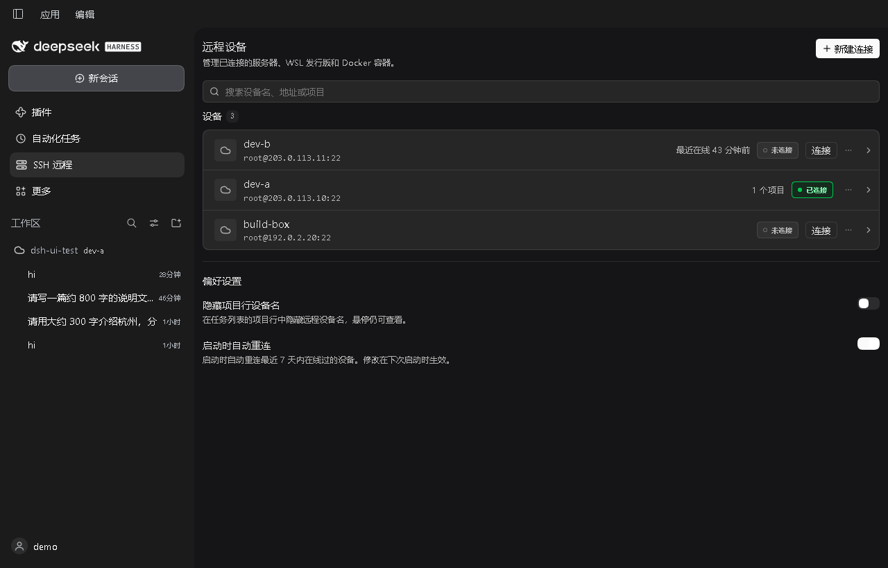
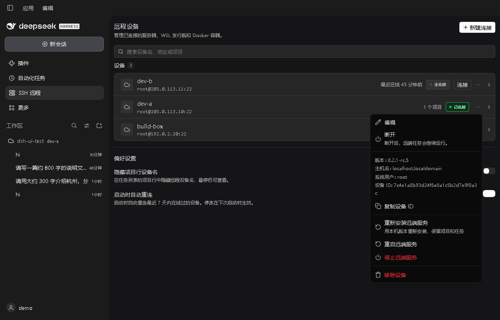
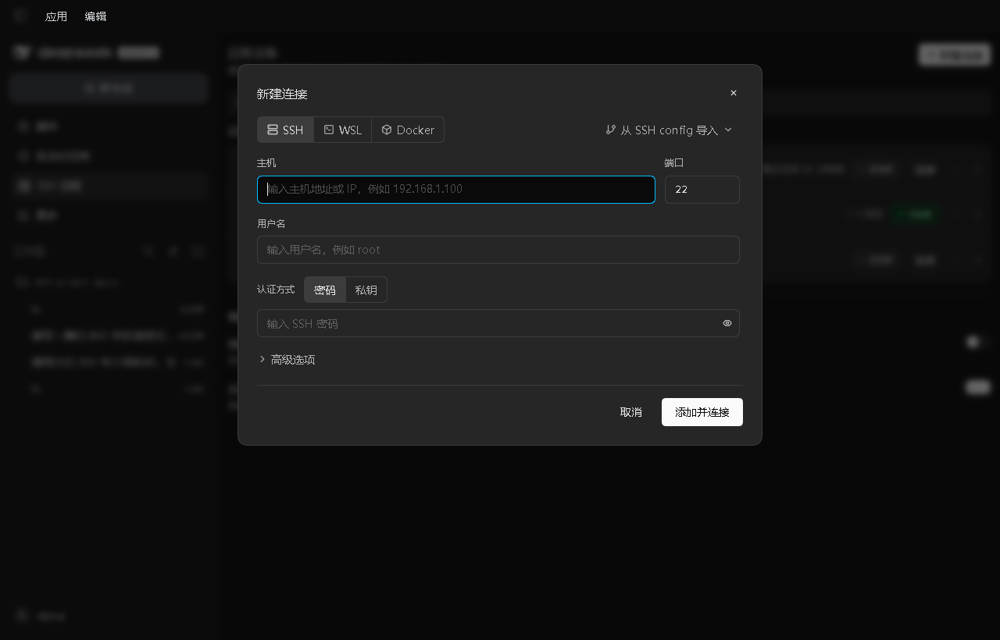
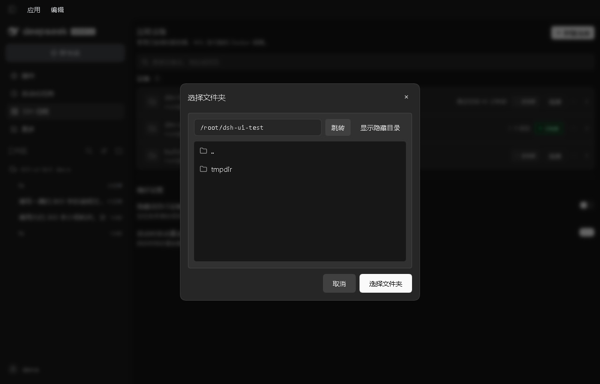
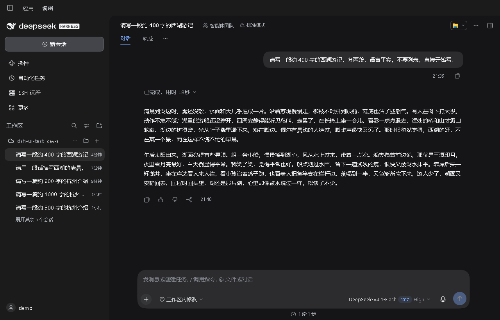
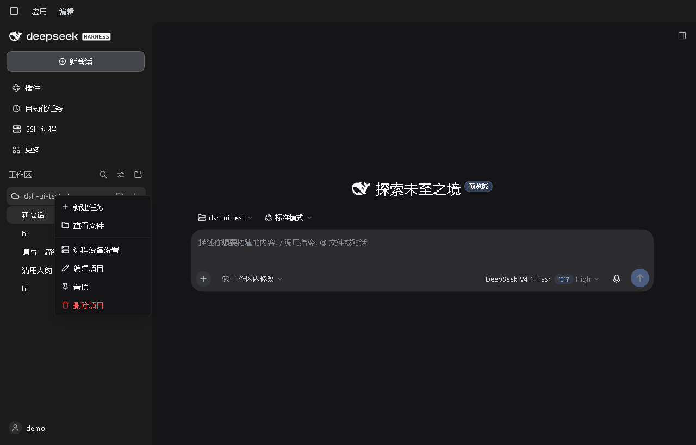
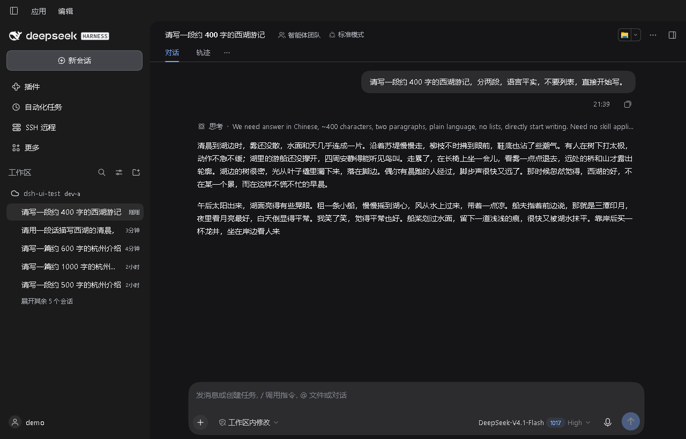

# dsh-ssh-remote

**Bring remote workspaces into DeepSeek Harness (dsh): SSH, WSL and Docker in one place.**

[简体中文](README.md) · [English](README.en.md)

A persistent dsh runs on the remote machine; the local app only picks folders, chats and shows status. Close the local app and the remote agent — plus any answer in progress — keeps running. Want the full DSH UI of that machine in your own browser? One click.

> Target: DeepSeek Harness Desktop 0.2.x. The plugin deploys the dsh build already installed on this computer, so there is no version to pick.

---

## Demo

Screenshots come from a real dsh session on a real SSH host; device names and IPs are replaced with documentation ranges.

### Remote devices



One row per machine: status cloud, `root@host:22`, last seen, project count. The search box filters by name, address or project. Offline, needs-update and updating devices each carry their own marker.

### Device menu



Edit, disconnect, run diagnostics, reinstall / restart / stop the remote service, remove the device. Disconnecting only drops the local connection; remote work keeps running.

### New connection



SSH, WSL and Docker in one dialog, with import from `~/.ssh/config`. The form checks the target before saving: name resolution, port, login; the host fingerprint is shown on first connect and remembered. On macOS no WSL entry appears at all.

### Create project


Project name, device, folder. The device list starts with This computer, then saved remote devices, and can add a new one inline.

### Remote folder picker



A remote host has no local path to browse, so the embedded SFTP browser handles it: type a path, show hidden directories, walk down the tree.

### Remote rows in the native sidebar



Remote workspaces appear directly in dsh's native sidebar: cloud (online / starting / offline / error) + project name + device name.



The `...` menu offers open remote DSH, new task, view files, edit project, pin and delete project. Delete removes only the local projection and the remote service; **the remote project folder is kept**.

### Streaming session



Answers are generated remotely and appear word by word locally, just like a local session. The agent process, tool calls and file access all run on the remote host.

---

## What it does

| | |
|---|---|
| Targets | SSH (password / key / agent), WSL distributions on Windows, Docker containers |
| Add devices | A wizard that tests before saving, shows the host fingerprint, and imports SSH config |
| Create projects | One form on the main surface: name, device, folder. Native dialog locally, embedded browser remotely |
| Native integration | Projected into the native sidebar: cloud + project name + device name, with an inline edit / delete menu |
| Sessions | Remote streaming with reasoning, tool calls and cancel; closing the local app does not interrupt |
| Open remote DSH | One click mirrors the remote web UI onto a fixed local port and opens it in your own browser, cookie included |
| Status | Running / starting / stopped / error / unreachable, plus PID, uptime, memory, CPU and HTTP status |
| Diagnostics | One page per device: environment checks, runtime, service, local entry, host fingerprint, recent log, copyable as a report |
| Deploy | Installs Node and dsh, syncs model credentials, registers a systemd (or setsid) service |
| Platforms | No WSL on macOS |

---

## Opening the remote DSH

Every remote workspace already runs a complete dsh web app; it listens on `127.0.0.1` only and its startup log carries a one-time token, so this machine cannot reach it. The plugin does three things:

1. opens one `direct-tcpip` channel over the existing SSH connection and mirrors the remote port on a **fixed** local port per workspace;
2. reads the latest `dsh web: http://127.0.0.1:<port>/?token=…` from the running process log and rewrites it to the local port;
3. probes it first — the browser only opens once the token is accepted, and an expired token triggers one restart that mints a fresh one.

The port must stay fixed because dsh trades `?token=` for a 30-day cookie bound to `127.0.0.1:<port>`; a changing port would mean logging in again.

WSL targets open their own `127.0.0.1` directly, with no tunnel. Docker targets need the container to publish a port at create time, and the plugin says so plainly instead of failing a forwarding call.

---

## Diagnostics and error codes

Settings → Remote devices → `...` → Run diagnostics. The report is read-only: the same environment checks the wizard runs, the runtime version, the service state, the local entry, the host fingerprint and the last 40 log lines; each problem comes with the next action, and the whole thing can be copied as a report for an issue.

Every failed response carries `code`, `error`, `hint` and `retryable`; the full table is [docs/errors.md](docs/errors.md), generated from `lib/errors.js` by `npm run docs:errors`.

---

## Install

After DeepSeek Harness has started at least once:

```bash
# macOS / Linux / WSL
node <plugin-dir>/bin/install.mjs --profile desktop
```

```powershell
# Windows
node <plugin-dir>\bin\install.mjs --profile desktop
```

Fully restart DeepSeek Harness; the **SSH Remote** panel in the sidebar means it is installed.

Uninstall: `node <plugin-dir>\bin\uninstall.mjs --profile desktop`. This removes the local plugin only; delete remote workspaces from the UI.

---

## Use

1. **Add a device** — Settings → Remote devices → New connection; fill address and credentials, test, save.
2. **Create a project** — **Create project** on the main surface → pick a device → pick a folder → confirm trust and create. The first run installs dsh remotely; later runs reuse it.
3. **Chat** — click the remote workspace in the sidebar; answers stream from the remote host.
4. **Open in a browser** — the ↗ on the project row, or Open remote DSH in the row menu.
5. **Manage** — hover a remote row; the `...` menu opens the remote DSH, shows files, renames or deletes the project. Delete keeps the remote directory.

The **SSH Remote** panel only manages devices; workspaces are created from the main surface. The first empty device list shows a three-step card that never returns after “Do not show again”.

---

## Data and security

- Devices and settings live in the local `$DSH_HOME/ssh-remote/state.json` (mode 0600 on POSIX; on Windows it inherits the user-profile ACL) and are never written to the remote;
- SSH passwords and key passphrases go to the OS credential store: Windows Credential Manager, the macOS Keychain, or libsecret (`secret-tool`) on Linux. `state.json` keeps only an `auth.secretBackend` marker, never the secret; credentials follow the OS account, so moving to another computer requires re-entering the password. When no vault is available the 0600 file remains the fallback and the `secrets` check in `GET /ssh-remote/health` warns about it;
- The remote dsh listens on `127.0.0.1` only; no LAN port is exposed, and the local mirror binds `127.0.0.1` too;
- Host keys are recorded on first connect and later changes are rejected;
- Local model credentials can optionally be synced to the remote workspace with mode 0600.

---

## Limitations

- Remote targets need Linux, Node ≥ 24.9 (or permission to install the portable Node) and access to an npm registry;
- The first prompt in a session pays one remote boot (~3 s); follow-ups are immediate;
- No local mirror of remote files — the agent and tools run inside the target;
- WSL needs Windows with WSL installed; Docker containers need a published web port; Windows remote hosts are not supported.

## License

MIT

## Community

This open-source project is linked to and recognized by the [LINUX DO](https://linux.do/) community.

[](https://github.com/deepseek-ai/deepseek-harness)