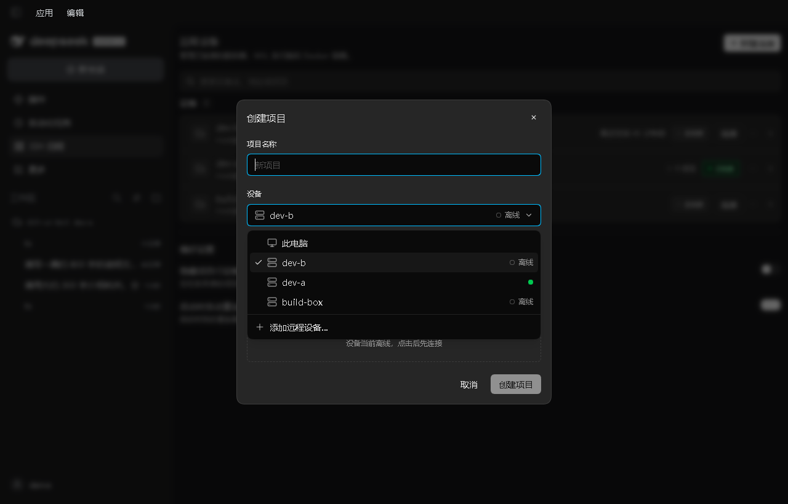

# dsh-ssh-remote

[](https://www.npmjs.com/package/dsh-ssh-remote)
[](https://github.com/longguanhong0755/dsh-ssh/actions/workflows/ci.yml)
[](LICENSE)
[](https://github.com/deepseek-ai/deepseek-harness)

**Remote machines as DeepSeek Harness workspaces: SSH, WSL and Docker in one list.**

[简体中文](README.md) · [English](README.en.md)

A persistent dsh runs on the remote machine; the local app only picks folders, chats and watches state. Close the local app and the remote agent keeps working, including the answer it is writing. Want the full DSH from that machine in a browser? One click.

> For DeepSeek Harness Desktop 0.2.x (local Node ≥ 22). The remote dsh version follows the one you already run locally — there is no version to pick.
> Repository `dsh-ssh`, npm package `dsh-ssh-remote`.

---

## What it is for

- **Heavy work on the strong machine.** A long task on the 32-core server goes there while the UI stays under your hand and the answer still streams in letter by letter.
- **Closing the window is not stopping.** The remote side is a service: close the laptop, quit dsh, the build and the generation continue; next time you reattach.
- **One machine is rarely enough.** Home desktop, work server, a WSL distribution, a container — all in one device list, with the device name next to every project, no IP addresses to remember.

---

## Screenshots

Captured from a real dsh against real SSH hosts; device names and IPs are replaced with documentation ranges.

### Device list


One row per device: a status cloud, `root@host:22`, last seen, project count. The search box filters by name, address or project. Offline devices, devices with an update and devices being updated each carry their own mark.

### Device menu


Edit, disconnect, run diagnostics, reinstall / restart / stop the remote service, remove the device. Disconnecting only drops the local connection; remote tasks keep running.

### New connection


One entry point for SSH, WSL and Docker, with import from `~/.ssh/config`. An address is checked before it is saved: resolvable, port open, credentials accepted — and the host fingerprint is shown once, confirmed, then remembered. No WSL entry appears on macOS.

### New project



A name, a device, a folder. The device picker starts with "this computer", then your saved devices, and can add a new one inline.

### Remote folder picker


A remote host has no local paths to browse, so there is an embedded SFTP browser: type a path, show hidden directories, walk down level by level.

### Remote workspaces in the native sidebar


Remote workspaces show up in the native sidebar: status cloud (online / starting / offline / error), project name, device name.


The `...` menu opens the remote DSH, starts a task, browses files, renames the project, pins it, deletes it. Deleting removes the local projection and the remote service only — **the remote project folder stays**.

### Streaming conversation


The answer is generated remotely and appears locally word by word, as smooth as a local session. The agent process, tool calls and file access all happen on the remote host.

---

## Capabilities

| | |
|---|---|
| Targets | SSH (password / key / agent), WSL distributions on Windows, Docker containers |
| Add a device | Connection wizard: test before save, fingerprint confirmation, SSH config import |
| Create a project | One form: name, device, folder; native dialog locally, embedded browser remotely |
| Native integration | Remote workspaces projected into the native sidebar with a status cloud, name and device |
| Conversations | Streaming from the remote side, thinking, tool calls, cancel; closing the local app does not stop it |
| Open remote DSH | One click bridges the remote web UI to a fixed local port and opens your own browser, login kept |
| Status | Running / starting / stopped / error / unreachable, plus PID, uptime, memory, CPU, HTTP status |
| Diagnostics | One page per device: environment checks, runtime, service, local entry, fingerprint, recent logs, copyable |
| Deployment | Installs Node and dsh, syncs model credentials, registers a systemd (or setsid) service |
| Platforms | No WSL entry on macOS |

---

## Install

**Option 1: clone and install (recommended, easy to update)**

```bash
git clone https://github.com/longguanhong0755/dsh-ssh
cd dsh-ssh
node bin/install.mjs --profile desktop
```

**Option 2: from npm**

```bash
npm i -g dsh-ssh-remote
dsh-ssh-install --profile desktop
```

Then **fully quit and restart** DeepSeek Harness (quit the process, not the window). An "SSH Remote" panel in the sidebar means it loaded. The installer only edits the profile manifest and a node_modules link; it never touches a remote server.

Uninstall: `node bin/uninstall.mjs --profile desktop` (`dsh-ssh-uninstall` for the npm install). That removes the local plugin only; remote services are cleaned up by deleting projects in the UI.

---

## First five minutes

1. **Add a device**: Settings → Remote devices → New connection. Address, user, authentication, then "Test connection" — only a passing target is saved, and the fingerprint is confirmed once.
2. **Create a project**: "Create project" on the main screen → device → folder → confirm trust. The first one installs dsh on that machine (Node download + npm install, usually a minute or two); later projects reuse it.
3. **Chat**: click the remote workspace in the sidebar. Answers stream from the remote side; closing the window does not stop them.
4. **Look at it in a browser**: the ↗ on the project row, or "Open remote DSH" in its menu, brings that machine's full web UI to your browser.
5. **When something is off**: device menu → Run diagnostics. One page shows environment, service, local entry, fingerprint and logs, copyable as a report.

The "SSH Remote" panel manages devices only; projects are created in the main window. The first successful connection shows a three-step card that can be dismissed for good.

---

## Open remote DSH

Every remote workspace already runs a full dsh web service; it only listens on `127.0.0.1` and carries a one-time token in its startup log, so the local machine cannot reach it. The plugin does three things:

1. opens a `direct-tcpip` channel over the existing SSH connection, mapping the remote port to a **fixed** local port (one per workspace, stable across restarts);
2. reads the latest `dsh web: http://127.0.0.1:<port>/?token=…` from the process log and rewrites it for the local port;
3. probes it first: the browser opens only once the token is accepted; if it expired, the remote service is restarted once for a fresh token.

The port is fixed because dsh trades `?token=` for a 30-day cookie bound to `127.0.0.1:<port>` — a new port would mean logging in again. Local ports come from 39180–39380; when one is taken the next free one is used and remembered.

WSL targets open their own `127.0.0.1` directly, with no tunnel. Docker targets need a published port at container creation; the plugin says so instead of failing a forward.

---

## Diagnostics and error codes

Settings → Remote devices → `...` → Run diagnostics. The report is read-only: it runs the same environment checks as the wizard and lists the runtime version, service state, local entry, host fingerprint and recent logs; when something fails it states the next action, and the whole thing copies out as a report for an issue.

Every failure response carries `code`, `error`, `hint` and `retryable`; the full table is [docs/errors.md](docs/errors.md), generated from `lib/errors.js` and refreshed with `npm run docs:errors`.

---

## FAQ

**Does the remote have to be Linux?**
Yes. The service stays up under systemd (when present) or setsid, both Linux-only. A Windows machine works through its WSL distribution, or run the environment in a container.

**Does the remote need Node installed?**
No. When the remote Node is older than 24.9, the first deploy downloads a portable Node (about 30 MB, verified, unpacked, used only by dsh) instead of touching the system. The environment checks tell you this before anything is written.

**Does closing the local app kill the remote session?**
No. The remote side is a standalone service; the local app attaches to it. State converges on its own when you come back, and a failed reconnect on startup is reported in a banner with a retry.

**Where are passwords stored?**
In the OS credential store where available (Windows Credential Manager, macOS Keychain, Linux libsecret); `state.json` keeps only a backend marker. Without one it falls back to a 0600 file and the `secrets` health check warns. Credentials follow the system account, so a new computer asks again.

**Is the remote dsh exposed to the LAN?**
No. The remote listens on `127.0.0.1` only, the local forward port also binds `127.0.0.1`, and cross-machine access goes through SSH.

**Does deleting a project delete the remote code?**
No. It removes the local projection and the remote service; the project folder is left untouched.

**What if the remote already runs another dsh version?**
Versions are managed for you: when the remote lags, its row shows an update, and one click installs it and restarts the service. Reinstall, restart and stop are in the device menu as well.

**Why does the first project take a minute or two?**
The first deploy uploads the dsh package, prepares the runtime, registers the service and starts the process. The progress bar shows the percentage and a remaining time derived from the observed rate; after that it is just a process start.

---

## Data and security

- Devices and settings live in the local `$DSH_HOME/ssh-remote/state.json` (0600 on POSIX; on Windows the user-profile ACL applies) and are never written to the remote host;
- SSH passwords and key passphrases go to the OS credential store first, with only `auth.secretBackend` left in `state.json`;
- The remote dsh listens on `127.0.0.1` only, and so does the local entry point;
- The host fingerprint is recorded on first connection; a changed fingerprint refuses to connect;
- Optionally the local model credentials are synced to the remote workspace with 0600 permissions.

---

## Limitations

- Remote targets need Linux, Node ≥ 24.9 (or permission to install the portable Node) and access to an npm registry;
- The first prompt in a session pays one remote boot (~3 s); follow-ups are immediate;
- No local mirror of remote files — the agent and tools run inside the target;
- WSL needs Windows with WSL installed; Docker containers need a published web port; Windows remote hosts are not supported.

---

## Development

```bash
git clone https://github.com/longguanhong0755/dsh-ssh
cd dsh-ssh
npm test          # unit and regression tests, plain node:test, no framework
npm run verify    # what CI runs: parse, tests, error table, styles, bundle, tarball
```

The client is split into parts under `lib/client/`, concatenated in filename order into `lib/client.js` (a classic script, no bundler). After editing a part run `npm run build:client` before committing; `npm run verify` fails and restores the file when the bundle is stale. Each part starts with `// part: <name> -- <what it owns>`.

Two conventions have gates so they cannot rot: a new error code needs `npm run docs:errors` to refresh `docs/errors.md`, and a new style class needs a real rule in `lib/client/30-styles.js` (`npm run styles` checks that the selector exists, not just the reference).

---

## License

MIT

## Community

This project is linked to and endorses the [LINUX DO](https://linux.do/) community.