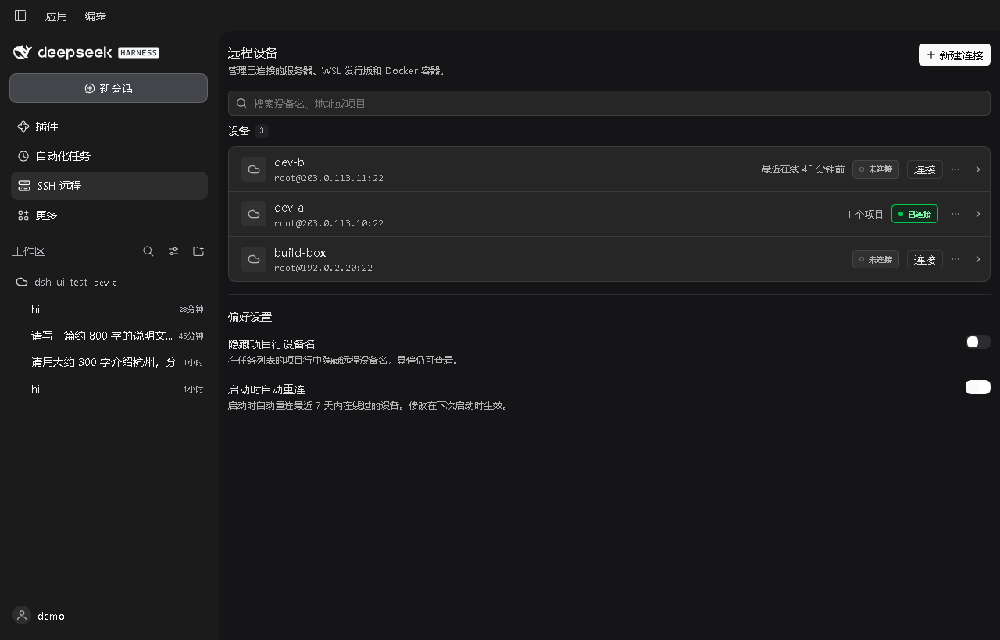
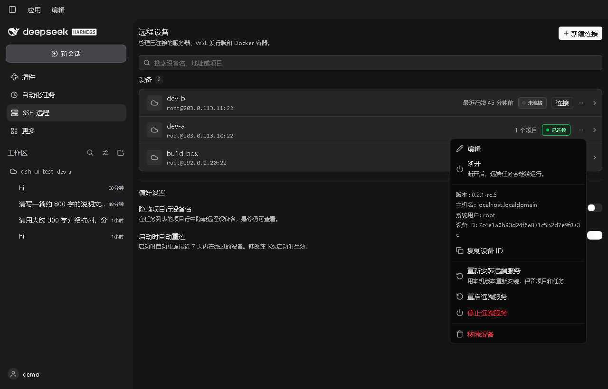
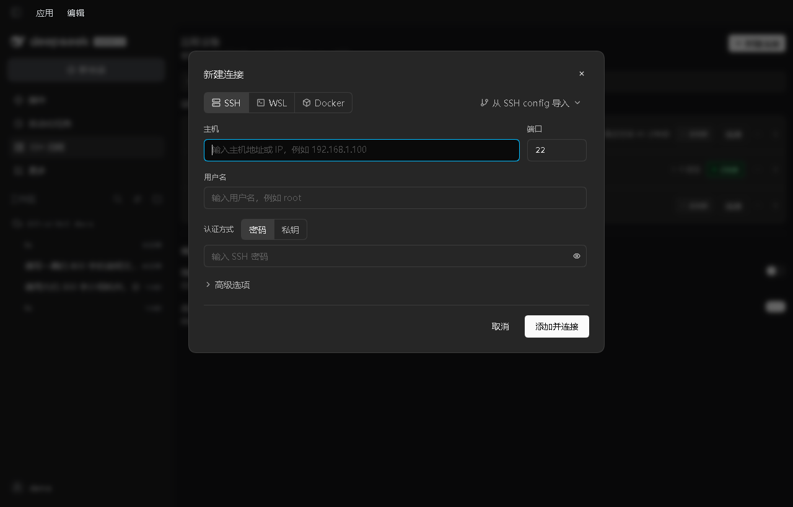
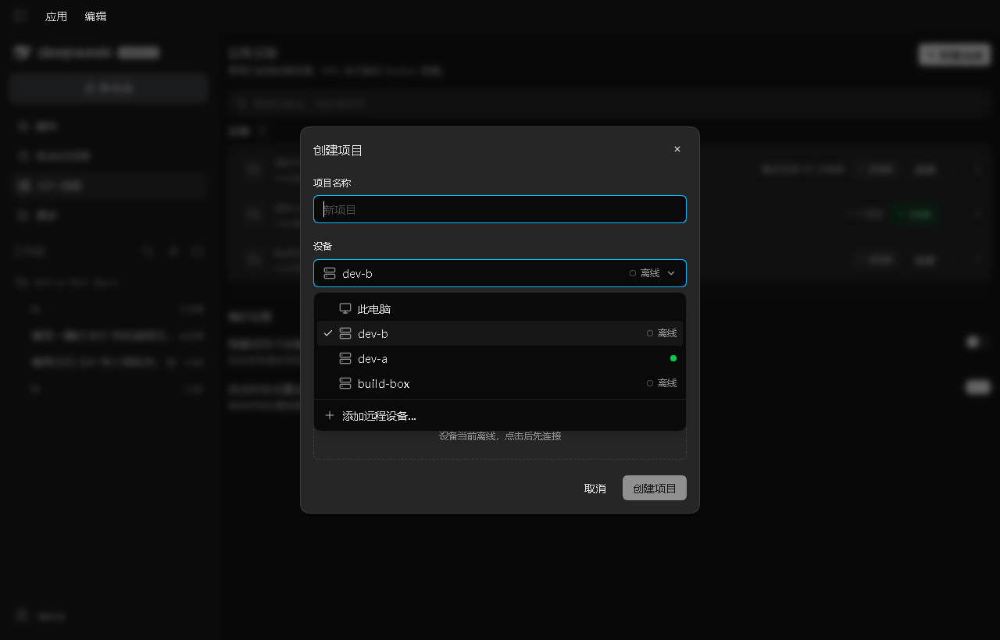
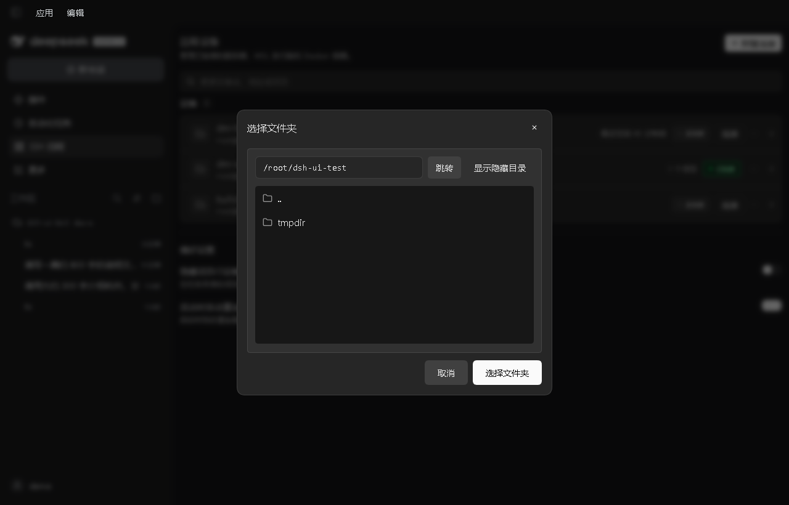
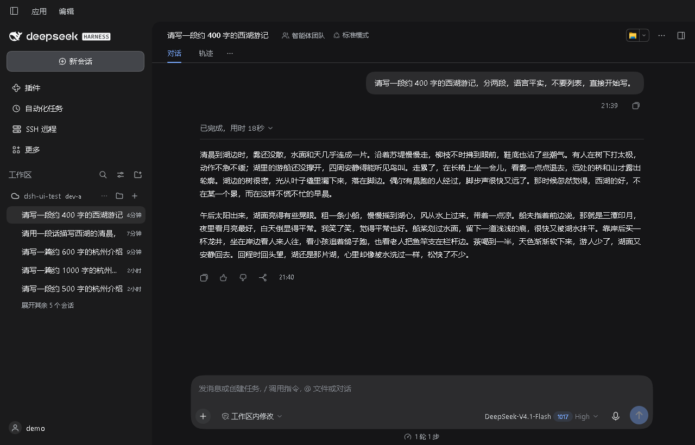
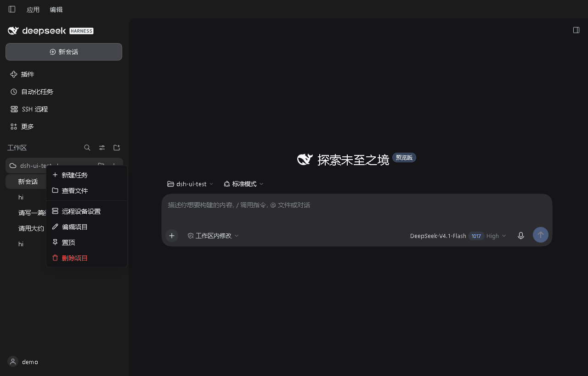
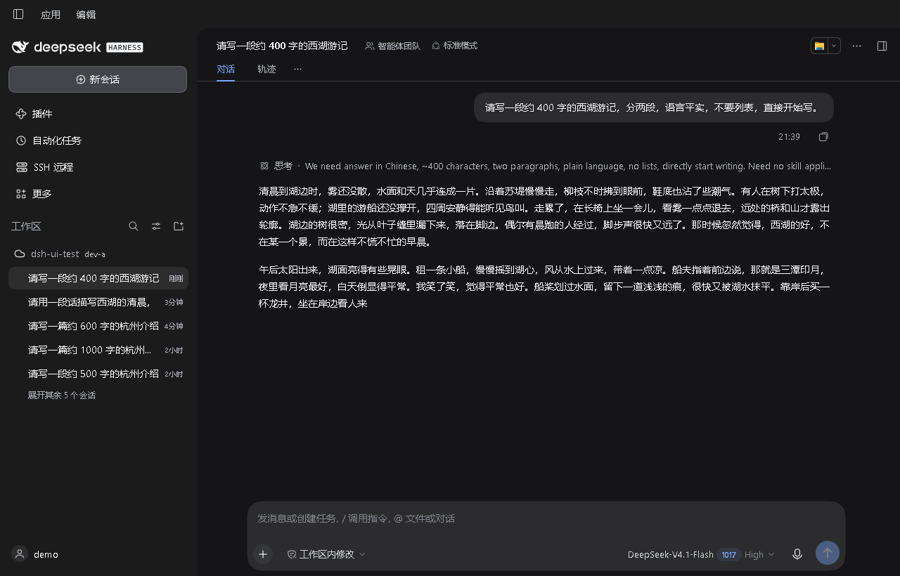

# dsh-ssh-remote

**ZCode-style remote workspaces for DeepSeek Harness (dsh): SSH, WSL and Docker.**

[简体中文](README.md) · [English](README.en.md)

A persistent dsh runs on the remote machine; the local app only picks folders, chats and shows status. Close the local app and the remote agent — plus any answer in progress — keeps running.

> Target: DeepSeek Harness Desktop `0.2.1-rc.5` (validated end-to-end on an AlmaLinux 9.5 SSH host)

---

## Demo

Screenshots come from a real dsh session on a real SSH host; device names and IPs are replaced with documentation ranges.

### Remote devices



One row per machine: status cloud, `root@host:22`, last seen, project count. The search box filters by name, address or project.

### Device menu



Edit, disconnect, reinstall / restart / stop the remote service, remove the device. Disconnecting only drops the local connection; remote work keeps running.

### New connection



SSH, WSL and Docker in one dialog, with import from `~/.ssh/config`. On macOS no WSL entry appears at all.

### Create project



Project name, device, folder. The device list starts with This computer, then saved remote devices, and can add a new one inline.

### Remote folder picker



A remote host has no local path to browse, so the embedded SFTP browser handles it: type a path, show hidden directories, walk down the tree.

### Remote rows in the native sidebar



Remote workspaces appear directly in dsh's native sidebar: cloud (online / starting / offline / error) + project name + device name.



The `...` menu offers new task, view files, edit project, pin and delete project. Delete removes only the local projection and the remote service; **the remote project folder is kept**.

### Streaming session



Answers are generated remotely and appear word by word locally, just like a local session. The agent process, tool calls and file access all run on the remote host.

---

## What it does

| | |
|---|---|
| Targets | SSH (password / key / agent), WSL distributions on Windows, Docker containers |
| Add devices | The same new-connection wizard as ZCode, including SSH config import |
| Create projects | One form on the main surface: name, device, folder. Native dialog locally, embedded browser remotely |
| Native integration | Projected into the native sidebar: cloud + project name + device name, with an inline edit / delete menu |
| Sessions | Remote streaming with reasoning, tool calls and cancel; closing the local app does not interrupt |
| Status | Running / starting / stopped / error / unreachable, plus PID, uptime, memory, CPU and HTTP status |
| Deploy | Installs Node and dsh, syncs model credentials, registers a systemd (or setsid) service |
| Platforms | No WSL on macOS, matching ZCode |

---

## Install

After DeepSeek Harness has started at least once:

```bash
# macOS / Linux / WSL
node <plugin-dir>/bin/install.mjs --profile desktop
```

```powershell
# Windows
node <plugin-dir>\bin\install.mjs --profile desktop
```

Fully restart DeepSeek Harness; the **SSH Remote** panel in the sidebar means it is installed.

Uninstall: `node <plugin-dir>\bin\uninstall.mjs --profile desktop`. This removes the local plugin only; delete remote workspaces from the UI.

---

## Use

1. **Add a device** — Settings → Remote devices → New connection; fill address and credentials, test, save.
2. **Create a project** — **Create project** on the main surface → pick a device → pick a folder → confirm trust and create. The first run installs dsh remotely; later runs reuse it.
3. **Chat** — click the remote workspace in the sidebar; answers stream from the remote host.
4. **Manage** — hover a remote row; the `...` menu renames or deletes the project. Delete keeps the remote directory.

The **SSH Remote** panel only manages devices; workspaces are created from the main surface.

---

## Data and security

- Devices and settings live in the local `$DSH_HOME/ssh-remote/state.json` (mode 0600 on POSIX; on Windows it inherits the user-profile ACL) and are never written to the remote;
- The remote dsh listens on `127.0.0.1` only; no LAN port is exposed;
- Host keys are recorded on first connect and later changes are rejected;
- Local model credentials can optionally be synced to the remote workspace with mode 0600.

---

## Limitations

- Remote targets need Linux, Node ≥ 22 (or a way to download the portable runtime) and access to an npm registry;
- The first prompt in a session pays one remote boot (~3 s); follow-ups are immediate;
- No local mirror of remote files — the agent and tools run inside the target;
- WSL needs Windows with WSL installed; Docker needs a running container; Windows remote hosts are not supported.

## License

MIT

## Community

This open-source project is linked to and recognized by the [LINUX DO](https://linux.do/) community.

[](https://github.com/deepseek-ai/deepseek-harness)
