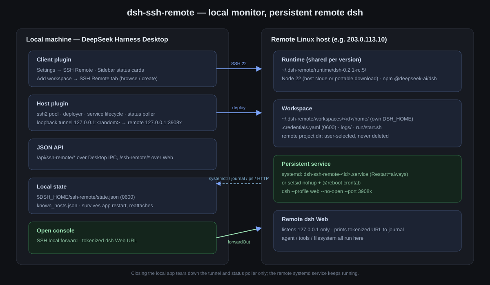
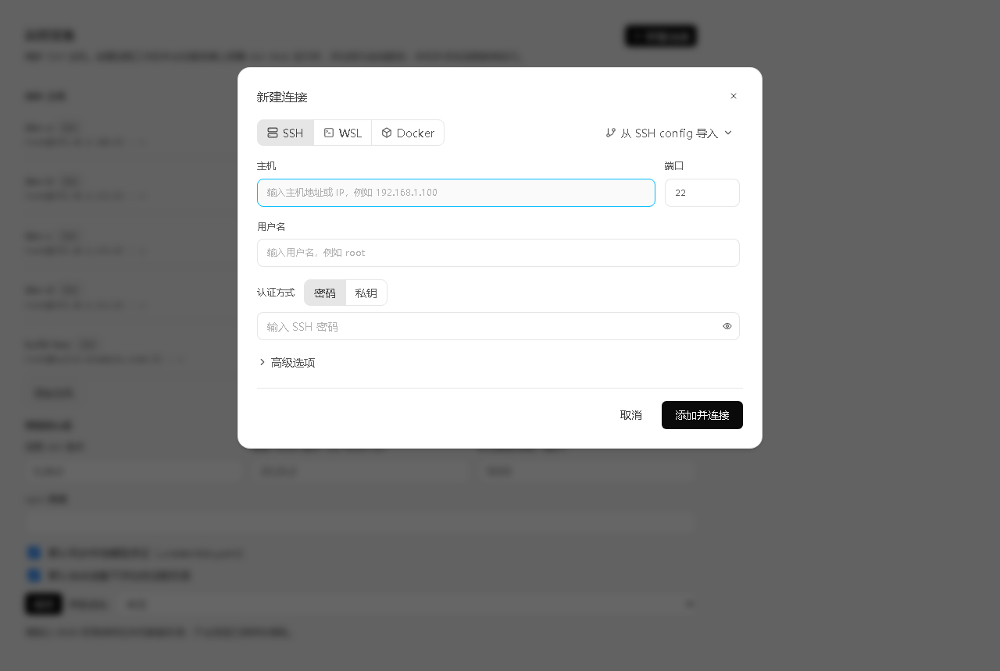
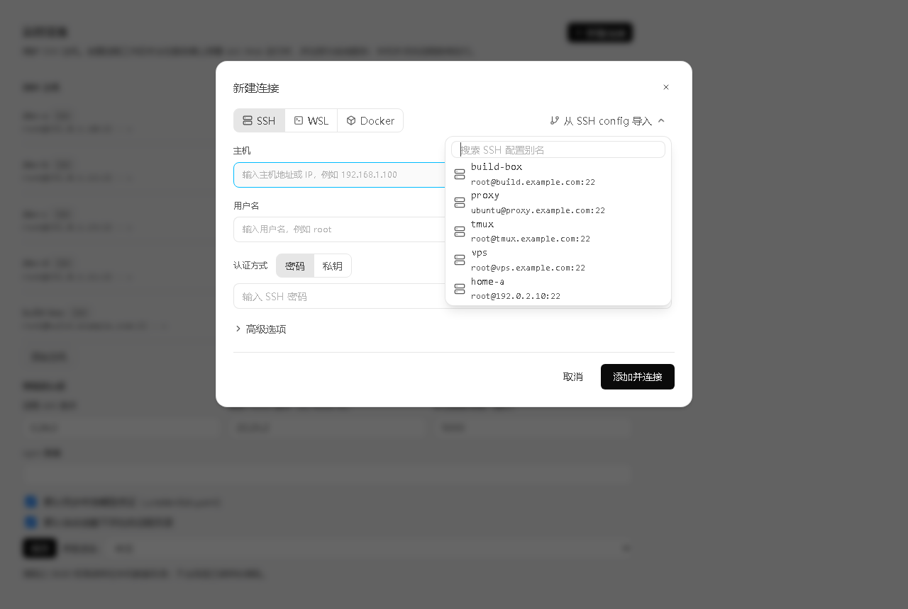
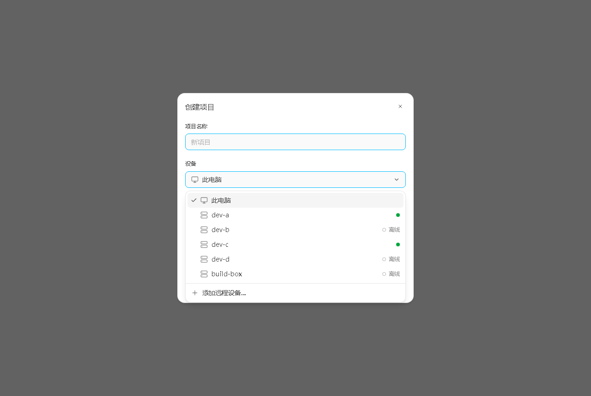
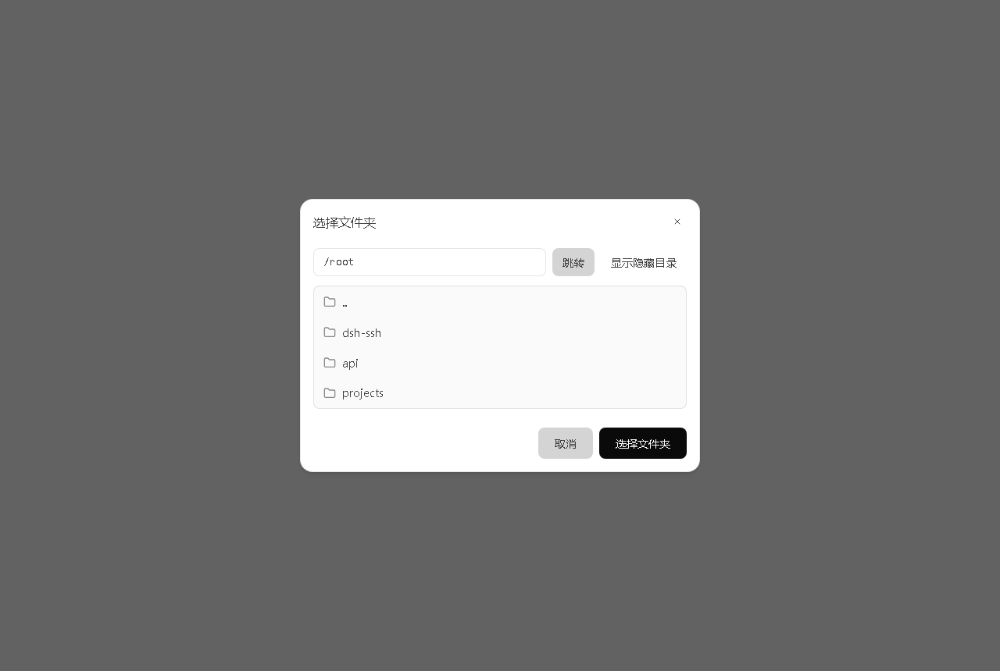
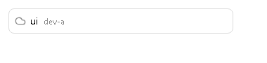

# dsh-ssh-remote

**ZCode-style remote workspaces for DeepSeek Harness (dsh): SSH, WSL and Docker.**

The remote dsh runs as a persistent systemd service (or `setsid` session) inside the SSH host, WSL distribution or Docker container, and remote sessions are executed by a detached `dsh --profile headless` runner there. The local app selects the workspace, shows the native chat, and monitors status; there is no local console proxy. Closing the local app does **not** stop the remote dsh.

> Target: DeepSeek Harness Desktop `0.2.1-rc.5`. Validated end-to-end against `203.0.113.10` (AlmaLinux 9.5).



## Screenshots

The Add-connection dialog is a 1:1 rebuild of ZCode's renderer components (`OVn` / `xVn` / `yVn` / `nVn` / `Smt` / `rmt` / `hmt` / `Cmt`): the same DOM structure, spacing, type scale and ZCode design tokens (light palette by default, dark palette under `body[data-ds-dark-theme]`), with device-first interaction:

- the left **SSH Remote** surface only adds and manages machines;
- workspaces are created from the main interface (**Create project** / **Add workspace**) on either This computer or a remote device;
- saved devices connect immediately; the device menu also offers **Add remote device…**;
- remote workspace rows show a status cloud, the project name and the device name, with a hover `...` menu for **Edit** and **Delete project**;
- **Choose folder** on This computer opens the operating system's own folder dialog; remote devices use the 1:1 ZCode folder browser.

| New connection (Settings → Remote devices) | SSH config import |
|---|---|
|  |  |

| Create project (device picker) | Select folder |
|---|---|
|  |  |

The three surfaces — new connection, create project and the centered folder picker — are rebuilt from the 3.17.2 renderer with the same DOM structure, class values, type scale and copy as ZCode. The screenshots use documentation-range addresses (`192.0.2.0/24`, `203.0.113.0/24`).

| Remote workspace row |
|---|
|  |

Native-sidebar remote rows follow ZCode's `virtual-project-row`: status cloud, project name, then the muted device name. Hover reveals **New session** and the `...` menu.

## Features

| Area | What it does |
|---|---|
| Targets | SSH (password / private key / passphrase / agent / keyboard-interactive), WSL distributions on Windows (`wsl.exe --exec bash -lc`, default or named distro/user) and Docker containers (`docker exec -i ... sh -lc`, name/id/prefix, must be running) |
| SSH hosts | TOFU host-key check; connection test with latency and remote Node detection |
| Add connection | 1:1 ZCode device flow: wizard steps 选择设备 / 连接 / 选择目录, `已保存的设备`, `SSH config 中的 Host`, `WSL 发行版` and `运行中的容器` sections, plus `新建 SSH 连接` / `手动输入 WSL` / `手动输入 Docker`; the settings step uses ZCode's exact per-kind forms (WSL distribution datalist + Linux user hints/root warning; Docker select/manual picker); minimize is available on every step and parks the wizard in a ZCode-style background card |
| Recent workspaces | the create dialog lists existing remote workspaces under the selected device; the native row is always one click away |
| Background connect | connecting and workspace creation can continue in the background; a bottom-right pill shows progress and opens the workspace on completion |
| SSH config import | parses `~/.ssh/config` Host blocks and fills host, port, username and IdentityFile |
| One-click create | the connect phase installs/reuses the shared dsh runtime; the directory step then only starts the service. Full chain: channel (SSH/WSL/Docker) → Node ≥ 22 (portable download when absent) → `@deepseek-ai/dsh` → credentials → launcher → systemd/setsid → health check |
| Persistence | systemd `Restart=always` (system unit, or user unit + linger) or `setsid nohup` + `@reboot` cron. Survives SSH disconnect and local app exit |
| Status monitor | running / starting / stopped / error / unreachable; PID, uptime, RSS, CPU, HTTP status, port, last check. CPU is sampled from `/proc/<pid>/stat` and RSS from `/proc/<pid>/status` (no lifetime-average or fabricated values) |
| Native workspace | each remote workspace is projected into the native sidebar as a ZCode-style row: cloud status glyph + project name + device name; its agent is bridged to a detached remote headless session |
| Row menu | hover `...` on a remote row → **Edit** (rename the project and native row) or **Delete project** (remove the local projection and service, keep the remote project directory) |
| Live streaming | the remote runner projects `agent/assistant-stream` frames over a single `tail -f` SSH channel, so reasoning and answer text appear incrementally instead of at step end |
| Warm runner | while a remote workspace is idle, the bridge pre-boots the next turn's headless runner and feeds it the prompt over a FIFO. The next message skips the 4-5 s process startup: measured `step/start` 0.20 s and first text 0.7 s after send, versus 4.96 s / 5.40 s cold. At most two runners are kept (~200 MB RSS each on the target), refreshed every 5 min and bounded by a TTL. `DSH_SSH_NO_PREWARM=1` disables it; `DSH_SSH_MAX_WARM` changes the cap |
| Lifecycle | automatic start on create/open; no per-workspace start/stop buttons. Remove from the row menu (service + runtime dir only; project dir kept) |
| Credentials | optionally copies local `$DSH_HOME/.credentials.yaml` (0600) into each remote workspace's own DSH home |
| Legacy import | imports hosts from ZCode's `~/.dsh/dsh-ssh.json` on first load |

The local side stays a monitor and chat surface: the agent process, tools and files live on the server.

## Install

After DeepSeek Harness has started at least once:

```powershell
node C:\work\dsh-ssh-remote\bin\install.mjs --profile desktop
```

The script adds a `link:` dependency and the bundle to `~/.dsh/profiles/desktop/package.json`, then creates a junction in the profile's `node_modules`. Fully restart DeepSeek Harness afterwards.

Manual install: add

```json
"dsh-ssh-remote": "link:C:/work/dsh-ssh-remote"
```

to `dependencies`, append `"dsh-ssh-remote"` to `dsh.profile.bundles`, and create

```powershell
cmd /c mklink /J "%USERPROFILE%\.dsh\profiles\desktop\node_modules\dsh-ssh-remote" "C:\work\dsh-ssh-remote"
```

## Use

1. **Add a machine** — open **Settings → Remote devices** or the left **SSH Remote** panel, click **New connection**, fill host/port/user/password or key, **Test connection**, **Save**. Importing `~/.ssh/config` Hosts is available in the same dialog. This panel only manages machines; it does not create workspaces.
2. **Create a workspace from the main interface** — click **Create project** in the conversation hero, or **Add workspace** in the sidebar. Pick **This computer** or a saved remote device, type a project name, then **Choose folder**.
   - **This computer** opens the operating system's folder dialog (falling back to the same ZCode folder dialog when the host has no native chooser).
   - A remote device opens the 1:1 ZCode folder browser (SFTP listing) after connecting.
3. **Create** deploys/reuses the remote runtime and adds the workspace to the native sidebar. The first create installs dsh on the host (about 1 minute, ~844 MB); later creates reuse the runtime.
4. **Remote rows** in the native sidebar show a cloud status glyph, the project name and the device name. Hover the row for **New session** and `...`; the menu offers **Edit** (rename) and **Delete project**.
5. **Chat** runs on the remote host and streams live: reasoning and answer text arrive incrementally over one SSH tail channel; the next turn's runner is already booted, so the first token appears in well under a second. Closing the local app does not stop the remote turn.
6. **Close DeepSeek Harness.** The remote runner keeps running. Reopen; the bridge resumes from its journal and the row reattaches to the same workspace.

## Data

Local: `$DSH_HOME/ssh-remote/state.json` (hosts, workspaces, settings; mode 0600), `known_hosts.json`.

Remote: `~/.dsh-remote/runtime/dsh-<version>/`, `~/.dsh-remote/workspaces/<id>/{home,logs,run}/`.

The remote Web listener binds `127.0.0.1` only; no LAN port is opened.

## Verified on 203.0.113.10

- AlmaLinux 9.5, x86_64, 8 vCPU, 31 GB RAM, Node v22.23.2, systemd 252.
- Remote install of `@deepseek-ai/dsh@0.2.1-rc.5` in ~1 minute.
- Service prints `dsh web: ...?token=...`; an unauthenticated HTTP request without the token returns `401` (used as readiness evidence only).
- Real metrics verified against `ps`: RSS matches `VmRSS` in `/proc/<pid>/status`; CPU is a fresh `/proc/<pid>/stat` delta, not the misleading lifetime `pcpu` average.
- Interaction chain verified end-to-end: saved-device connect → runtime prepare hits cache → folder picker → create → the new native workspace opens automatically.
- Remote rows render the cloud glyph, project name and device name; the hover menu renames/deletes the same workspace record and native row.
- Live streaming verified end-to-end with the real remote runner: `start` / `text-delta` / `reasoning-delta` frames reach the local bridge before the durable `assistant/message`; a long answer produced 140 live frames, and a second turn in the same session streamed normally.
- Warm runner measured against the same host: cold launch `step/start` 4.96 s and first text 5.40 s after send; prewarmed launch `step/start` 0.20 s and first text 0.7 s; a follow-up sent the instant the previous turn ended still takes the cold path (~3.3 s) because the next runner boots only after the previous process exits, but the session transcript is complete (`我上一条消息说了什么` returned the exact prior text).
- Resume verified: dispose the local bridge while the remote turn is running, attach a new bridge to the same session id → it restarts from the journal offset, drains the remaining JSONL and appends the final message/turn end without duplicates.
- Local **Choose folder** opens the system dialog in the desktop app; the harness also verifies the HTTP fallback when no native picker is exposed.
- After a workspace is removed from the row menu, the native projection drops the anchor row (no ghost remote project).
- After closing the local app for 10 s: same remote PID, uptime kept increasing, `systemctl is-active = active`.
- Reopening the local app restored the same PID and continuous uptime.
- Logs and remote model listing (`loaded 2 model(s)`) still work through the device-management routes.
- root services log to journal, not a file under `/root`, to avoid SELinux `209/STDOUT` on RHEL-family hosts.
- SSH/WSL/Docker share one command layer; on the development machine (no WSL optional feature, no Docker daemon) the WSL/Docker discovery and error paths were verified end-to-end in the UI (`当前系统未检测到可用的 WSL 环境` / `当前系统未检测到可用的 Docker 环境`), including the per-kind forms and badges. Full deploy inside a live WSL distribution or container still needs a host that provides one.

## Limitations

- Linux remotes only: WSL distributions and Docker containers must provide a Linux `bash`/`sh`, Node ≥ 22 or a way to download the portable runtime (curl, wget or an existing Node).
- WSL requires a Windows desktop with the WSL optional feature installed; Docker requires a running daemon and a running container.
- The remote host needs access to an npm registry (default npmmirror).
- A prompt sent the instant the previous turn ends still pays one cold runner start (~3 s). The warm runner cannot boot earlier because it must load the session after the previous process has written the finished turn; normal typing pauses hit the warm path. Targets without `mkfifo` (some minimal containers) fall back to cold starts automatically.
- Credentials are synced, but local model selection/settings are not yet mapped to the remote headless runner.
- Background connect progress is in-memory: restarting the local app drops the pill (created workspaces are restored from `state.json`); there is no cancel button for an in-flight install/create.
- No local mirror of remote project files; the agent and tools run inside the target.
- Docker workspaces do not survive removal of their container; WSL workspaces survive until the distribution is terminated/unregistered.

- WSL2 HTTP proxy auto-rewriting (ZCode maps a loopback proxy to the Windows host gateway) is not implemented; use a reachable registry/proxy inside the distribution.

## Uninstall

```powershell
node C:\work\dsh-ssh-remote\bin\uninstall.mjs --profile desktop
```

This removes the local link/dependency selection only. Delete remote workspaces from the UI to stop their services.

## Reverse-engineering notes

See [`docs/zcode-ssh-reverse-engineering.md`](docs/zcode-ssh-reverse-engineering.md) for the ZCode 3.17.2 SSHBackend / WSL / Docker backends, remote asset deployment, the 3.17.2 connect wizard (stages, install confirmation, error card, log panel), the device-management "新建连接" dialog, the "创建项目" dialog and the embedded "选择文件夹" picker, plus the `rea` evidence summary.

## License

MIT
