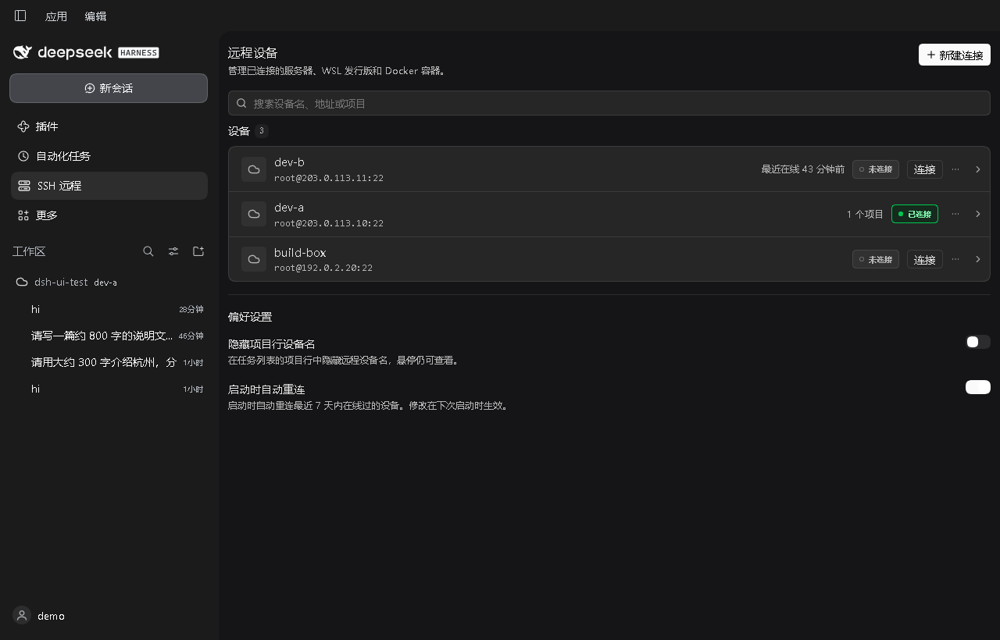
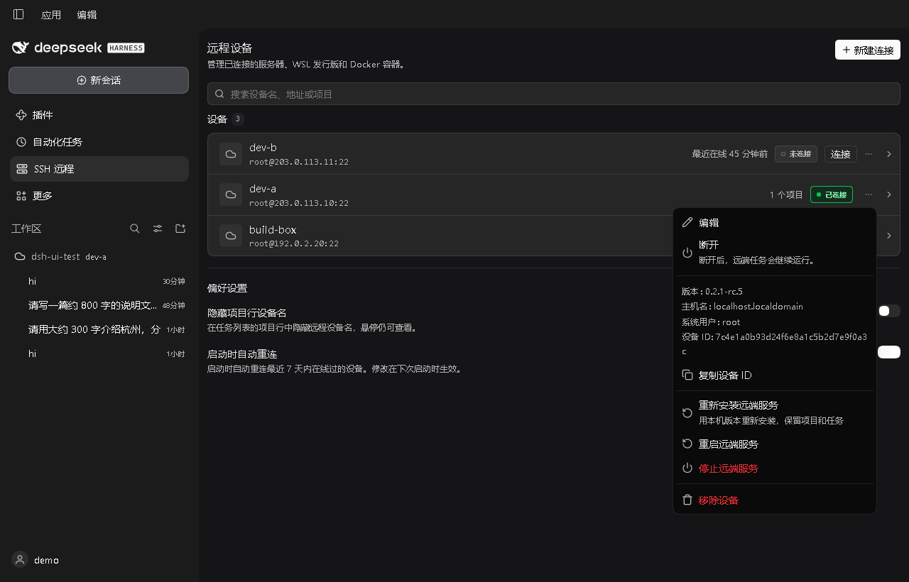
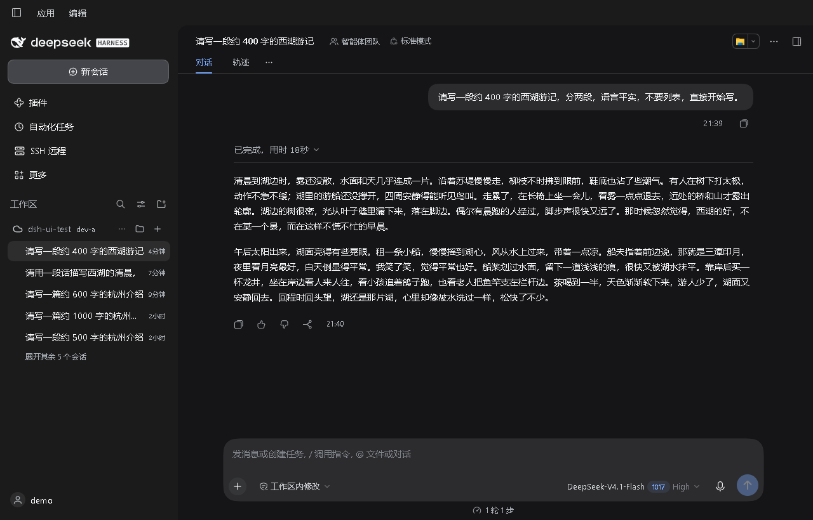
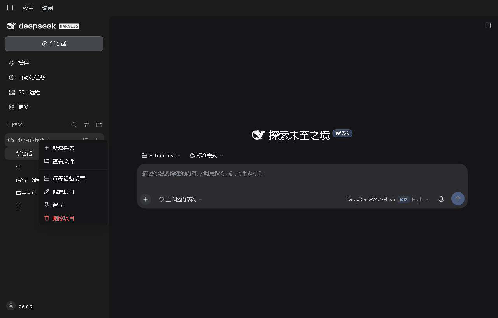

# dsh-ssh-remote

[](https://www.npmjs.com/package/dsh-ssh-remote)
[](https://github.com/longguanhong0755/dsh-ssh/actions/workflows/ci.yml)
[](LICENSE)
[](https://github.com/deepseek-ai/deepseek-harness)

**把远程机器变成 DeepSeek Harness 的工作区：SSH、WSL、Docker，一个列表管起来。**

[简体中文](README.md) · [English](README.en.md)

在远程机器上跑一个常驻的 dsh，本机只负责选目录、聊天、看状态。关掉本机 dsh，远程的 agent 和正在生成的回答继续跑；想用浏览器打开那台机器上完整的 DSH，点一下就行。

> 适用 DeepSeek Harness Desktop 0.2.x（本机 Node ≥ 22）。远端 dsh 版本跟随你本机已装的那一个，不需要单独挑版本。
> 仓库是 `dsh-ssh`，npm 包名 `dsh-ssh-remote`。

---

## 它解决什么

- **重活在更强的机器上。** 笔记本跑不动的长任务放到 32 核的服务器，界面仍然在你手边，回答照样逐字出现。
- **关掉窗口不等于停下。** 远程是常驻服务，合上电脑、退出 dsh，远端继续编译、继续生成；下次打开接着看。
- **一台机器不够就一排。** 家里主机、公司服务器、WSL 发行版、容器里的环境都进同一个设备列表，项目名后面标着设备，不用记 IP。

---

## 效果演示

截图来自真实运行的 dsh 和真实 SSH 主机，设备名与 IP 已替换为文档保留地址。

### 远程设备管理



一台设备一行：状态云朵、`root@host:22`、最近在线时间、项目数。搜索框按设备名、地址或项目过滤。离线、需要更新、正在更新各有自己的标记。

### 设备菜单



编辑、断开、运行诊断、重装 / 重启 / 停止远端服务、移除设备。断开只断本机连接，远程任务照常运行。

### 新建连接


SSH / WSL / Docker 三类统一入口，支持从 `~/.ssh/config` 导入。填地址时先体检再保存：主机能不能解析、端口开不开、账号能不能登录，一次说清楚；首次连接显示主机指纹，确认后记住。macOS 上不出现 WSL 入口。

### 创建项目


项目名 + 设备 + 文件夹。设备下拉第一项是「此电脑」，后面是已保存的远程设备，也能直接添加新设备。

### 选择远程文件夹


远程没有本地路径可浏览，所以用内嵌的 SFTP 文件夹浏览器：输入路径、显示隐藏目录、逐级进入。

### 原生侧栏里的远程工作区



远程工作区直接出现在 dsh 原生侧栏：云朵（在线 / 启动中 / 离线 / 异常）+ 项目名 + 设备名。



`...` 菜单可打开远程 DSH、新建任务、查看文件、编辑项目、置顶、删除项目。删除只清本机投影和远端服务，**远程项目文件夹保留**。

### 流式会话


回答在远端生成、本地逐字出现，和本地会话一样顺滑。agent 进程、工具调用和文件读写都发生在远程主机上。

---

## 能做什么

| | |
|---|---|
| 目标 | SSH（密码 / 私钥 / agent）、Windows 上的 WSL 发行版、Docker 容器 |
| 添加设备 | 新建连接向导：先测试再保存、指纹确认、一键导入 SSH config |
| 创建项目 | 主界面一个表单：项目名、设备、文件夹；本机弹系统对话框，远程用内嵌浏览器 |
| 原生集成 | 远程工作区投影到原生侧栏，云朵 + 项目名 + 设备名，行内菜单编辑 / 删除 |
| 会话 | 远端流式返回，支持思考、工具调用、取消；关闭本地不中断 |
| 打开远程 DSH | 一键把远端 Web 界面接到本机固定端口，用你自己的浏览器打开，登录态留在浏览器里 |
| 状态 | 运行中 / 启动中 / 已停止 / 异常 / 不可达，以及 PID、运行时长、内存、CPU、HTTP 状态 |
| 诊断 | 一台设备一页：环境检查、运行时、服务状态、本机入口、主机指纹、最近日志，可复制成报告 |
| 部署 | 自动安装 Node 与 dsh、同步模型凭证、注册 systemd（或 setsid）服务 |
| 平台 | macOS 上不提供 WSL |

---

## 安装

**方式一：克隆后安装（推荐，便于随时更新）**

```bash
git clone https://github.com/longguanhong0755/dsh-ssh
cd dsh-ssh
node bin/install.mjs --profile desktop
```

**方式二：从 npm 安装**

```powershell
npm i -g dsh-ssh-remote
dsh-ssh-install --profile desktop
```

装完**完全退出并重启** DeepSeek Harness（不是关窗口，是退出进程），侧边栏出现「SSH 远程」即成功。插件只改 profile 清单和 node_modules 链接，不碰任何远程服务器。

卸载：`node bin/uninstall.mjs --profile desktop`（npm 安装用 `dsh-ssh-uninstall`）。只移除本机插件；远端服务需要先在界面上删除项目。

---

## 快速上手

1. **加设备**：设置 → 远程设备 → 新建连接。填地址、账号、登录方式，点「测试连接」——通了再保存，指纹确认一次。
2. **建项目**：主界面「创建项目」→ 选设备 → 选文件夹 → 确认信任。首次会在这台机器上装 dsh（下载 Node + npm 安装，通常一两分钟），之后复用。
3. **开始聊**：点侧栏里的远程工作区，回答在远端流式生成。关掉窗口，远端继续跑。
4. **用浏览器看**：项目行上的 ↗ 或行菜单「打开远程 DSH」，远端完整的 Web 界面在本机浏览器里打开。
5. **出问题**：设备菜单 → 运行诊断，一页看完环境、服务、入口、指纹和日志，可复制成报告。

左侧「SSH 远程」面板只管理设备；工作区统一在主界面创建。第一次连上设备时有一张三步引导卡，点「不再提示」后不再出现。

---

## 打开远程 DSH

远端每个工作区本来就跑着一个完整的 dsh Web 服务，只是只监听 `127.0.0.1`、启动日志里带着一次性令牌，本机够不着。插件做三件事：

1. 通过已有的 SSH 连接开一条 `direct-tcpip` 通道，把远端端口映射到本机一个**固定**端口（每个工作区一个，重开不变）；
2. 从当前进程日志里取最新的 `dsh web: http://127.0.0.1:<端口>/?token=…`，把地址改成本机端口；
3. 先自己探一次：令牌被接受才打开浏览器，过期就重启一次远端服务换新令牌。

之所以固定端口，是因为 dsh 用 `?token=` 换一个 30 天的 cookie，而 cookie 绑定在 `127.0.0.1:<端口>` 上——端口一变就要重新登录。本地端口从 39180–39380 里取空闲的，被占用时顺延并记住新值。

WSL 目标直接开它自己的 `127.0.0.1`，不经过隧道；Docker 目标需要容器创建时发布端口，插件会明确告诉你这一点，而不是给你一个转发失败。

---

## 诊断与错误码

设置 → 远程设备 → `...` → 运行诊断。报告是只读的：跑一遍和向导相同的环境检查，列出运行时版本、服务状态、本机入口、主机指纹和最近日志；出问题时直接给下一步动作，可一键复制成报告贴到 issue 里。

每个失败响应都带 `code`、`error`、`hint`、`retryable`，完整对照表见 [docs/errors.md](docs/errors.md)（由 `lib/errors.js` 生成，`npm run docs:errors` 更新）。

---

## 常见问题

**远端必须是 Linux 吗？**
是。远端服务用 systemd（有的话）或 setsid 常驻，两者都是 Linux 的。Windows 主机请用它的 WSL 发行版，或把环境跑在容器里。

**远端需要先装 Node 吗？**
不必须。远程 Node 低于 24.9 时，首次部署会下载一份便携 Node（约 30 MB，校验后解压，只给 dsh 用），不污染系统。环境检查会把这件事提前告诉你。

**关掉本机 dsh，远程会话会断吗？**
不会。远端是独立常驻服务，本机只是接上去。重新打开后状态会自己收敛；启动时若连不上，会有一条横幅说明并可以一键重试。

**密码存在哪？**
优先存系统凭据库（Windows 凭据管理器 / macOS 钥匙串 / Linux libsecret），`state.json` 里只有一个后端标记。没有可用凭据库时退回 0600 文件，`health` 的 `secrets` 检查会告警。凭据跟随系统账户，换电脑要重新输入。

**远端 dsh 会暴露到局域网吗？**
不会。远端只监听 `127.0.0.1`，本机转发端口也只监听 `127.0.0.1`，跨机访问走 SSH。

**删除项目会删掉远端代码吗？**
不会。删除只清本机的投影和远端服务，项目文件夹原样保留。

**远端已经装了别的版本 dsh 怎么办？**
插件按版本管理：远端版本落后时设备行上会出现「有更新」，一键装新版本并重启服务；也可以重装 / 重启 / 停止，都在设备菜单里。

**为什么第一次建项目要等一两分钟？**
首次部署要上传 dsh 包、准备 runtime、注册服务、拉起进程。进度条会显示百分比和按当前速度估算的剩余时间；第二次起只是启动一个进程。

---

## 数据与安全

- 设备与设置保存在本机 `$DSH_HOME/ssh-remote/state.json`（POSIX 上 0600；Windows 依赖用户配置目录的 ACL），不写入远程；
- SSH 密码与私钥口令优先存进系统凭据库，`state.json` 只留 `auth.secretBackend` 标记，密码不落盘；
- 远程 dsh 只监听 `127.0.0.1`，本机入口也只监听 `127.0.0.1`；
- 首次连接记录主机指纹，之后指纹变化会拒绝连接；
- 可选把本机模型凭证以 0600 同步到远程工作区。

---

## 限制

- 远程目标需要 Linux 环境，Node ≥ 24.9（或允许插件装便携 Node），且能访问 npm 镜像；
- 每个会话首轮要付一次约 3 秒的远端进程启动，之后追问即时；
- 本地不镜像远程文件，agent 与工具都在目标环境执行；
- WSL 需要 Windows + 已安装 WSL；Docker 容器需要发布过 Web 端口；不支持 Windows 远程主机。

---

## 参与开发

```bash
git clone https://github.com/longguanhong0755/dsh-ssh
cd dsh-ssh
npm test          # 单元与回归测试，只用 node:test，没有测试框架依赖
npm run verify    # CI 跑的全套：解析、测试、错误表、样式、客户端产物、打包清单
```

界面代码拆在 `lib/client/` 下的若干 part 文件里，按文件名顺序拼成 `lib/client.js`（classic script，不用打包器）。改了任一部分先 `npm run build:client` 再提交，`npm run verify` 会在产物过期时失败并还原文件。每个 part 的第一行固定为 `// part: <name> -- <这段负责什么>`。

两个容易漏的约定，脚本会拦：新增的错误码要 `npm run docs:errors` 同步到 `docs/errors.md`；新增的样式类要真的写进 `lib/client/30-styles.js`（`npm run styles` 检查，防止只改了引用没改选择器）。

---

## License

MIT

## 社区

本开源项目已链接并认可 [LINUX DO](https://linux.do/) 社区。