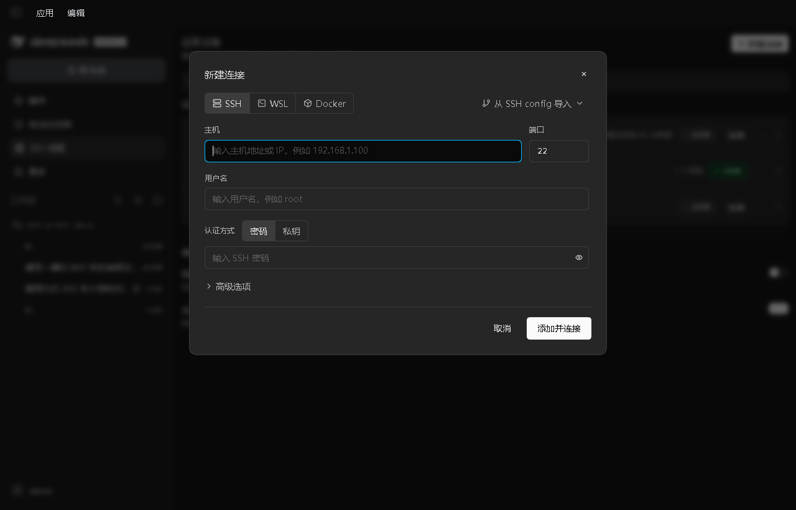
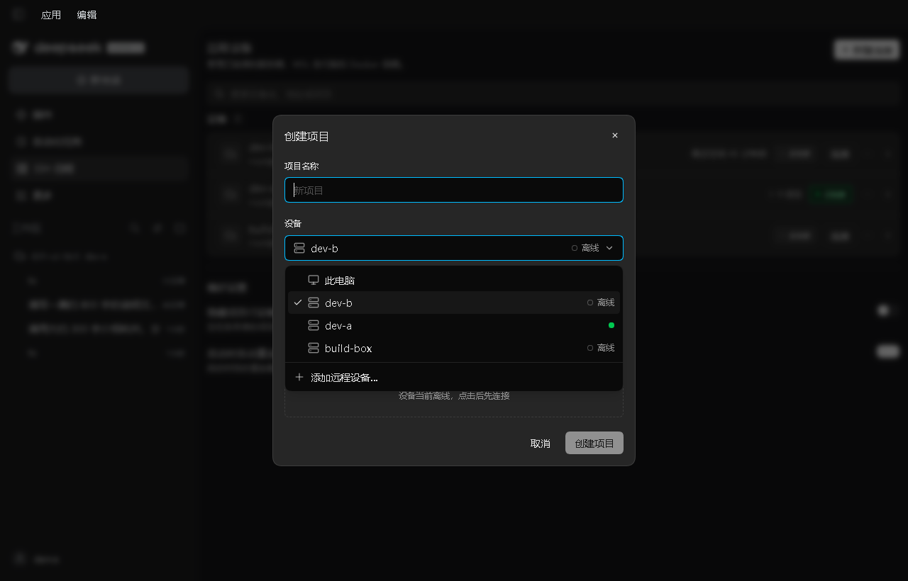
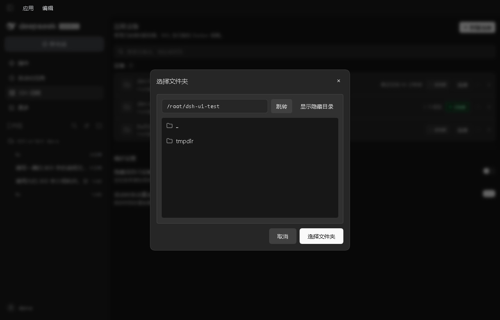
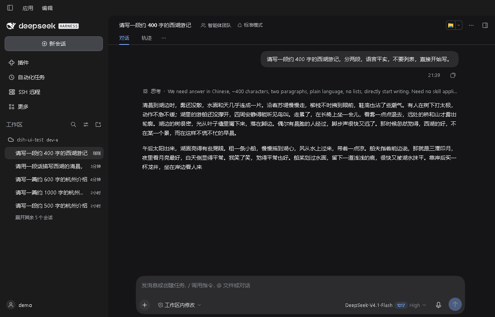

# dsh-ssh-remote

**把远程工作区带进 DeepSeek Harness（dsh）：SSH、WSL、Docker，一处管理。**

[简体中文](README.md) · [English](README.en.md)

远程机器上跑一个常驻的 dsh，本机只负责选目录、聊天、看状态。关掉本地 dsh，远程 agent 和正在生成的回答都继续跑；想直接用浏览器看那台机器上的完整 DSH，点一下就行。

> 适用版本：DeepSeek Harness Desktop 0.2.x。插件跟随本机已安装的 dsh 版本部署到远端，不需要单独选版本。

---

## 效果演示

截图来自真实运行的 dsh 和真实 SSH 主机，设备名与 IP 已替换为文档保留地址。

### 远程设备管理


一台设备一行：状态云朵、`root@host:22`、最近在线时间、项目数。搜索框可按设备名、地址或项目过滤。离线设备、需要更新的设备、正在更新的设备各有自己的标记。

### 设备菜单


编辑、断开、运行诊断、重装 / 重启 / 停止远端服务、移除设备。断开只断本机连接，远程任务照常运行。

### 新建连接



SSH / WSL / Docker 三类统一入口，支持从 `~/.ssh/config` 导入。填地址时先体检再保存：主机能不能解析、端口开不开、账号能不能登录，一次说清楚；首次连接会显示主机指纹，确认后记住。macOS 上不出现任何 WSL 入口。

### 创建项目



项目名 + 设备 + 文件夹。设备下拉第一项是「此电脑」，后面是已保存的远程设备，也能直接添加新设备。

### 选择远程文件夹



远程没有本地路径可浏览，所以用内嵌的 SFTP 文件夹浏览器：输入路径、显示隐藏目录、逐级进入。

### 原生侧栏里的远程工作区


远程工作区直接出现在 dsh 原生侧栏：云朵（在线 / 启动中 / 离线 / 异常）+ 项目名 + 设备名。


`...` 菜单可打开远程 DSH、新建任务、查看文件、编辑项目、置顶、删除项目。删除只清本机投影和远端服务，**远程项目文件夹保留**。

### 流式会话



回答在远端生成、本地逐字出现，和本地会话一样顺滑。agent 进程、工具调用和文件读写都发生在远程主机上。

---

## 能做什么

| | |
|---|---|
| 目标 | SSH（密码 / 私钥 / agent）、Windows 上的 WSL 发行版、Docker 容器 |
| 添加设备 | 新建连接向导：先测试再保存、指纹确认、一键导入 SSH config |
| 创建项目 | 主界面一个表单：项目名、设备、文件夹；本机弹系统对话框，远程用内嵌浏览器 |
| 原生集成 | 远程工作区投影到原生侧栏，云朵 + 项目名 + 设备名，行内菜单编辑 / 删除 |
| 会话 | 远端流式返回，支持思考、工具调用、取消；关闭本地不中断 |
| 打开远程 DSH | 一键把远端 Web 界面接到本机固定端口，用你自己的浏览器打开，登录态留在浏览器里 |
| 状态 | 运行中 / 启动中 / 已停止 / 异常 / 不可达，以及 PID、运行时长、内存、CPU、HTTP 状态 |
| 诊断 | 一台设备一页：环境检查、运行时、服务状态、本机入口、主机指纹、最近日志，可复制成报告 |
| 部署 | 自动安装 Node 与 dsh、同步模型凭证、注册 systemd（或 setsid）服务 |
| 平台 | macOS 上不提供 WSL |

---

## 打开远程 DSH

远端每个工作区本来就跑着一个完整的 dsh Web 服务，只是只监听 `127.0.0.1`、启动日志里带着一次性令牌，本机够不着。插件做三件事：

1. 通过已有的 SSH 连接开一条 `direct-tcpip` 通道，把远端端口映射到本机一个**固定**端口（每个工作区一个，重开不变）；
2. 从当前进程日志里取最新的 `dsh web: http://127.0.0.1:<端口>/?token=…`，把地址改成本机端口；
3. 先自己探一次：令牌被接受才打开浏览器，过期就重启一次远端服务换新令牌。

之所以固定端口，是因为 dsh 用 `?token=` 换一个 30 天的 cookie，而 cookie 绑定在 `127.0.0.1:<端口>` 上——端口一变就要重新登录。

WSL 目标直接开它自己的 `127.0.0.1`，不经过隧道；Docker 目标需要容器创建时发布端口，插件会明确告诉你这一点，而不是给你一个转发失败。

---

## 诊断与错误码

设置 → 远程设备 → `...` → 运行诊断。报告是只读的：跑一遍和向导相同的环境检查，列出运行时版本、服务状态、本机入口、主机指纹和最近 40 行日志；出问题时直接给下一步动作，可以一键复制成报告贴到 issue 里。

每个失败响应都带 `code`、`error`、`hint`、`retryable`，完整对照表见 [docs/errors.md](docs/errors.md)（由 `lib/errors.js` 生成，`npm run docs:errors` 更新）。

---

## 安装

在 DeepSeek Harness 至少启动过一次之后：

```bash
# macOS / Linux / WSL
node <插件目录>/bin/install.mjs --profile desktop
```

```powershell
# Windows
node <插件目录>\bin\install.mjs --profile desktop
```

然后完全退出并重新启动 DeepSeek Harness，侧边栏出现「SSH 远程」即安装成功。

卸载：`node <插件目录>\bin\uninstall.mjs --profile desktop`。只移除本地插件，远程服务需在界面上删除项目。

---

## 使用

1. **添加设备**：设置 → 远程设备 → 新建连接，填地址和账号，先测试再保存。
2. **创建项目**：主界面「创建项目」→ 选设备 → 选文件夹 → 确认信任并创建。首次会在远端安装 dsh，之后复用。
3. **开始对话**：点侧栏里的远程工作区直接聊天，回答在远端流式生成。
4. **用浏览器打开**：项目行上的 ↗ 或行菜单里的「打开远程 DSH」。
5. **管理**：悬停远程行，`...` 里可打开远程 DSH、查看文件、编辑名称或删除项目；删除保留远程目录。

左侧「SSH 远程」面板只管理设备，工作区统一在主界面创建。设备第一次连上时会有一张三步引导卡，点「不再提示」后不再出现。

---

## 数据与安全

- 设备与设置保存在本机 `$DSH_HOME/ssh-remote/state.json`（POSIX 上为 0600；Windows 依赖用户配置目录的 ACL），不写入远程；
- SSH 密码与私钥口令优先存进系统凭据库：Windows 凭据管理器、macOS 钥匙串、Linux libsecret（`secret-tool`）。`state.json` 只留下 `auth.secretBackend` 标记，密码不落盘；凭据跟随系统账户，换一台电脑需要重新输入密码。系统没有可用凭据库时退回 0600 文件，`GET /ssh-remote/health` 的 `secrets` 检查会给出告警；
- 远程 dsh 只监听 `127.0.0.1`，不向局域网暴露端口；本机入口也只监听 `127.0.0.1`；
- 首次连接记录主机指纹，之后指纹变化会拒绝连接；
- 可选把本机模型凭证以 0600 同步到远程工作区。

---

## 限制

- 远程目标需要 Linux 环境，Node ≥ 24.9（或允许插件装便携 Node），且能访问 npm 镜像；
- 每个会话首轮要付一次约 3 秒的远端进程启动，之后追问即时；
- 本地不镜像远程文件，agent 与工具都在目标环境执行；
- WSL 需要 Windows + 已安装 WSL；Docker 容器需要发布过 Web 端口；不支持 Windows 远程主机。

## License

MIT

## 社区

本开源项目已链接并认可 [LINUX DO](https://linux.do/) 社区。

[](https://github.com/deepseek-ai/deepseek-harness)