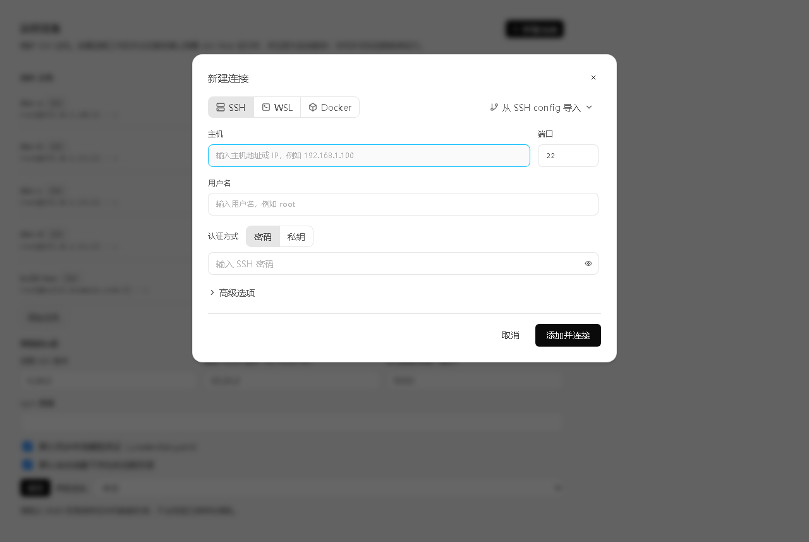
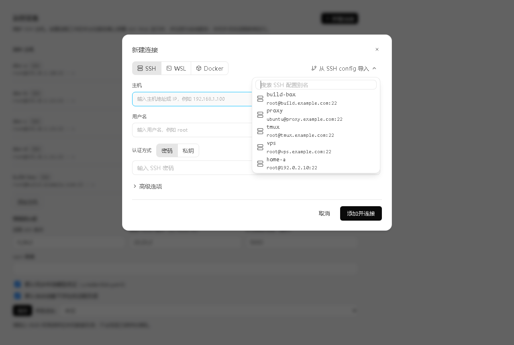
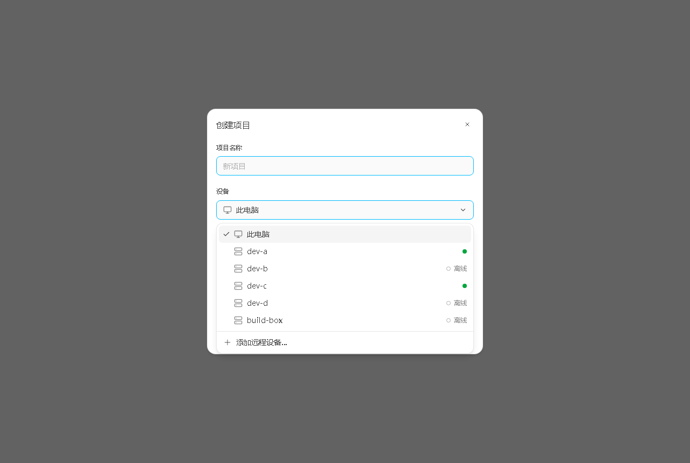
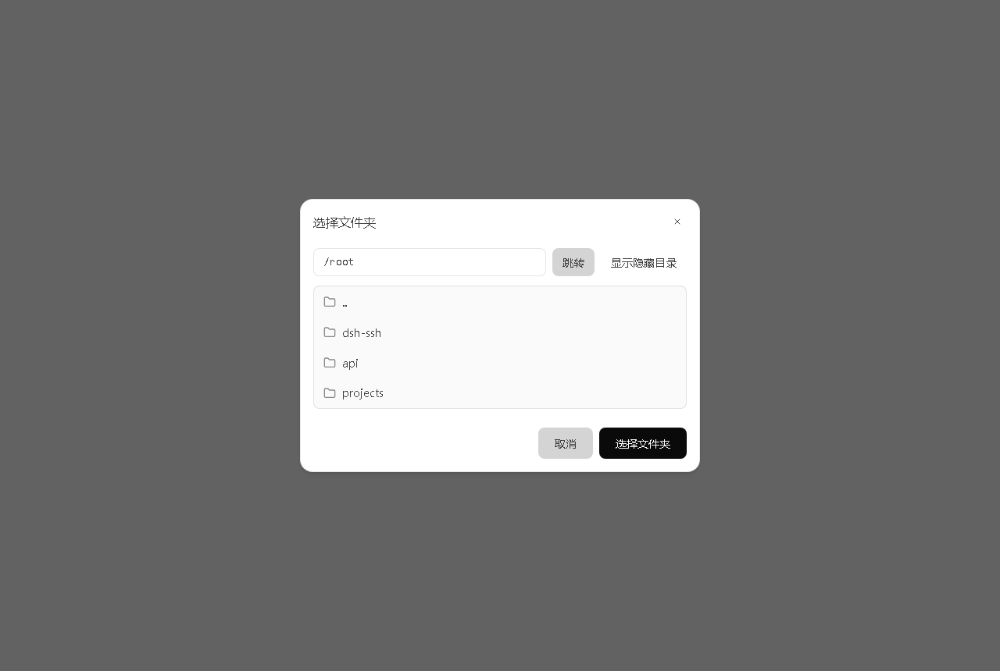
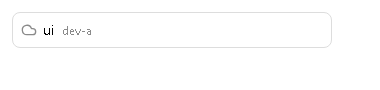

# dsh-ssh-remote

**把 ZCode 的远程工作区能力复刻到 DeepSeek Harness（dsh）的插件：SSH、WSL 和 Docker。**

远程 `dsh` 在 SSH 服务器、WSL 发行版或 Docker 容器中以 systemd 服务（或 `setsid` 脱离会话）持续运行；远程会话由目标环境内脱离终端的常驻 `dsh --profile sdk` 进程执行（不可用时回退到 `--profile headless`）。本地只负责选择工作区、显示原生对话和监控状态，不再代理远程控制台。关闭本地 dsh 之后，目标环境里的远程 dsh **不会停止**。

> 适用版本：DeepSeek Harness Desktop `0.2.1-rc.5`（本插件在 203.0.113.10 上完成端到端验证）。

---

## 它做了什么

| 能力 | 说明 |
|---|---|
| 目标类型 | SSH（密码 / 私钥 / 私钥口令 / SSH agent / keyboard-interactive）、Windows 上的 WSL 发行版（`wsl.exe --exec bash -lc`，默认或指定 distro/user）和 Docker 容器（`docker exec -i … sh -lc`，支持名称/id/前缀，必须处于运行中） |
| SSH 主机管理 | 主机密钥 TOFU 校验；连接测试、延迟与远程 Node 检测 |
| 添加连接（ZCode 1:1） | 完整复刻 ZCode 向导：步骤条「选择设备 / 连接 / 选择目录」、`已保存的设备`、`SSH config 中的 Host`、`WSL 发行版`、`运行中的容器` 分组，以及 `新建 SSH 连接` / `手动输入 WSL` / `手动输入 Docker`；设置页使用 ZCode 各类型原始表单（WSL 发行版 datalist + Linux 用户提示/root 警告；Docker 选择/手动分段 + 容器选择浮层）；已保存设备直接点击连接；每一步都可最小化为 ZCode 式后台卡片 |
| 最近工作区 | 每个设备显示最近 3 个远程目录；点击即打开对应的原生工作区（服务未运行时自动在后台拉起），不需要重走向导 |
| 连接可后台 | 建立连接和启动工作区都可以「在后台继续」；右下角浮动提示显示进度，完成后直接打开工作区，重新点开则恢复向导 |
| 从 SSH config 导入 | 解析本机 `~/.ssh/config` 的 Host 块，自动填充主机、端口、用户名和 IdentityFile |
| 一键创建远程工作区 | 连接阶段就检查/安装共享 dsh 运行时，目录步骤只做服务和健康检查；自动完成：连通目标（SSH/WSL/Docker）→ 检测/下载 Node → 安装 `@deepseek-ai/dsh` → 同步模型凭证 → 写入启动脚本 → 注册 systemd/`setsid` 服务 → 健康检查 |
| 远程常驻 | 服务方式优先 `systemd`（root 系统服务，或非 root 用户的 user service + linger）；无 systemd 时用 `setsid nohup`，并写入 `@reboot` crontab。SSH 断开、本地关闭都不影响远程 |
| 本地状态监控 | 运行中 / 启动中 / 已停止 / 异常 / 主机不可达；PID、运行时长、内存、CPU、HTTP 状态、端口、最近检测时间。CPU 用 `/proc/<pid>/stat` 0.5 秒差值计算，内存取 `/proc/<pid>/status` 的 VmRSS，不再使用会误导的 `ps` 生命周期平均值 |
| 原生工作区 | 每个远程工作区投影到左侧原生工作区列表；其 agent 由 `lib/bridge.js` 转发到远端常驻 SDK 会话；面板和最近目录都能直接选中该原生行 |
| 常驻 runner | 每个会话对应一个常驻的 `dsh --profile sdk` JSON-RPC 进程：prompt 从 FIFO 写入，事件通过一条 tail 通道流式返回。首轮付一次约 3 秒的启动，之后每轮 `step/start` 约 0.15 秒、首段文本约 1.0~1.3 秒；上下文、工具调用和取消都在同一进程内完成。空闲 30 分钟由 watchdog 回收（`DSH_SSH_SDK_TTL`），本机重启会按 journal offset 直接重连存活进程。`DSH_SSH_NO_SDK=1` 可关闭，`DSH_SSH_SDK_PROVIDER` / `DSH_SSH_SDK_MODEL` 可覆盖远端模型 |
| 预热回退 | SDK profile 无法启动时（旧版远端、宿主不支持），自动回退到 `dsh --profile headless --json` 的 FIFO 预热 runner：预热命中时 `step/start` 0.20 秒、首段文本 0.7 秒，冷启动 4.96 / 5.40 秒；最多保留 2 个预热进程（每个约 200 MB RSS），每 5 分钟刷新一次，并有 TTL 兜底。`DSH_SSH_NO_PREWARM=1` 关闭预热，`DSH_SSH_MAX_WARM` 调整上限 |
| 生命周期 | 创建/打开时自动启动，不再暴露单工作区的启停按钮；从行菜单删除时停止并清理服务与运行目录（保留远程项目目录） |
| 凭证同步 | 默认把本机 `$DSH_HOME/.credentials.yaml` 以 0600 同步到远程每个工作区自己的 `DSH_HOME`，远程模型可直接使用 |
| 兼容旧配置 | 首次加载会自动导入 ZCode 的 `~/.dsh/dsh-ssh.json` 主机 |

本地 UI 只做「原生对话 + 看状态」，agent 进程、工具和文件都在服务器上执行——这正是需求里「那边正常跑、这边只看状态」的形态。

---

## 界面

「新建连接」向导按 ZCode 渲染层组件 `OVn`/`xVn`/`yVn`/`nVn`/`Smt`/`rmt`/`hmt`/`Cmt` 做 1:1 重建：DOM 层级、间距、字号、圆角和 ZCode 设计令牌（默认浅色，`body[data-ds-dark-theme]` 下切换为 ZCode 深色）与 ZCode 一致，交互为设备优先：

- 左侧 **SSH 远程** 只负责添加/管理机器，不创建工作区；
- 工作区统一在主界面（**创建项目** / **添加工作区**）创建，可选本机或远程设备；
- 已保存设备点击直接连接，设备菜单里还有 **添加远程设备…**；
- 远程工作区行显示状态云朵 + 项目名 + 设备名，悬停 `...` 可 **编辑** / **删除项目**；
- 本机 **选择文件夹** 弹操作系统原生文件夹对话框；远程设备仍是 1:1 ZCode 文件夹浏览器。

| 新建连接（设置 → 远程设备） | 从 SSH config 导入 |
|---|---|
|  |  |

| 创建项目（设备选择） | 选择文件夹 |
|---|---|
|  |  |

三个界面——新建连接、创建项目、居中的选择文件夹——均按 ZCode 3.17.2 渲染层重建：DOM 结构、class 数值、字号与文案一致。截图使用文档保留地址段（`192.0.2.0/24`、`203.0.113.0/24`）。

| 远程工作区行 |
|---|
|  |

原生侧栏的远程行按 ZCode `virtual-project-row` 排布：状态云朵、项目名、设备名（弱化色）。悬停出现 **新建会话** 和 `...` 菜单。

---

## 架构

```
┌────────────────────────── 本机 ──────────────────────────┐
│ DeepSeek Harness Desktop (dsh 0.2.1-rc.5)               │
│                                                         │
│  dsh-ssh-remote 宿主插件                                 │
│   ├─ ssh2 连接池（密码/密钥/agent/TOFU）                 │
│   ├─ 远程部署器（Node + dsh + 凭证 + 服务）              │
│   ├─ 状态轮询（systemctl/journalctl/proc/HTTP）            │
│   ├─ 远端会话桥（lib/bridge.js，本地会话镜像）             │
│   └─ /api/ssh-remote/* 路由（Desktop IPC / Web）          │
│                                                         │
│  dsh-ssh-remote 客户端插件                               │
│   ├─ 设置 → 远程设备（主机 CRUD / 测试 / 部署默认值）     │
│   ├─ 侧边栏 → SSH 远程（只添加/管理机器）                 │
│   ├─ 原生侧栏行装饰（云朵 + 项目名 + 设备名 + 行菜单）    │
│   └─ 主界面创建项目 / 添加工作区（本机或远程设备）        │
└──────────────────────────┬──────────────────────────────┘
                           │ SSH (22)
┌──────────────────────────▼──────────────────────────────┐
│ 远程 Linux 服务器                                         │
│                                                         │
│  ~/.dsh-remote/runtime/dsh-0.2.1-rc.5/   ← npm 安装      │
│  ~/.dsh-remote/workspaces/<id>/home/     ← 独立 DSH_HOME │
│  ~/.dsh-remote/workspaces/<id>/logs/     ← setsid 日志   │
│  systemd: dsh-ssh-remote-<id>.service                    │
│    ExecStart: node .../dsh/lib/bin.js --profile web      │
│               --no-open --port 3908x                     │
│    监听 127.0.0.1:3908x，journal 输出 token URL           │
│  SDK runner: setsid dsh --profile sdk（FIFO stdin + tail）│
│    （每个本地会话一个常驻进程，事件流回本地；失败回退）    │
│                                                         │
│  远程项目目录（用户选择，不会被删除）                      │
└─────────────────────────────────────────────────────────┘
```

远程 dsh Web 只绑定 `127.0.0.1`；本机通过 SSH direct-tcpip 隧道访问，不向局域网暴露端口。

---

## 安装

### 方式一：安装脚本（推荐）

在 **DeepSeek Harness 已经启动过一次**（已存在 `~/.dsh/profiles/desktop`）之后：

```powershell
node C:workdsh-ssh-remote\bin\install.mjs --profile desktop
```

脚本会：

1. 在 `~/.dsh/profiles/desktop/package.json` 的 `dependencies` 写入 `link:<本插件绝对路径>`；
2. 把 `dsh-ssh-remote` 追加到 `dsh.profile.bundles`；
3. 在 `~/.dsh/profiles/desktop/node_modules/` 建立目录联接（Windows junction / POSIX symlink）。

然后**完全退出并重新启动 DeepSeek Harness**。

### 方式二：手动安装

编辑 `~/.dsh/profiles/desktop/package.json`：

```json
{
  "dependencies": {
    "dsh-ssh-remote": "link:C:/work/dsh-ssh-remote"
  },
  "dsh": {
    "profile": {
      "bundles": [
        "...",
        "dsh-ssh-remote"
      ]
    }
  }
}
```

并建立链接：

```powershell
cmd /c mklink /J "%USERPROFILE%\.dsh\profiles\desktop\node_modules\dsh-ssh-remote" "C:workdsh-ssh-remote"
```

重启 DeepSeek Harness。侧边栏出现 **SSH 远程** 即安装成功。

## 卸载

```powershell
node C:workdsh-ssh-remote\bin\uninstall.mjs --profile desktop
```

卸载只移除本地插件与 bundle 选择，不会删除远程服务；需要时在远程工作区行的 `...` 菜单里点「删除项目」。

---

## 使用

### 1. 添加 SSH 主机

1. 左下角账号菜单 → **设置** → **远程设备（dsh-ssh-remote）**；
2. 点 **添加主机**，填写名称、IP、端口、用户名、密码（或私钥路径 / 口令）；
3. 点 **测试连接**，应显示 `连接成功 · <延迟>ms · Linux x86_64 · Node v22.x`；
4. **保存**。

> 首次连接采用 TOFU：记录主机指纹；之后指纹变化会拒绝连接（可在主机表单里改成 `verify` 或 `off`）。

### 2. 创建远程工作区（只能在主界面）

- 对话首页的 **创建项目**；或
- 侧栏工作区列表的 **添加工作区**。

左侧 **SSH 远程** 面板只添加/管理机器，不再创建工作区。创建弹窗是 ZCode 同款「创建项目」：

1. **项目名称**：留空时使用远程目录名；
2. **设备**：**此电脑** 或已保存的远程设备；设备菜单里可以 **添加远程设备…**；
3. **选择文件夹**：
   - **此电脑** → 弹操作系统原生文件夹对话框（Electron 的 `__DSH_DIRECTORY_PICKER__`，浏览器下走宿主 `uiWorkspace.pickDirectory()`）；宿主没有原生选择器时回退到同款 ZCode 目录浏览弹窗；
   - **远程设备** → 先连接，再打开 1:1 ZCode 内嵌文件夹浏览器（SFTP 列表、路径输入、显示隐藏目录）；
4. **信任此文件夹吗？**：点 **创建项目** 后先弹出 ZCode 同款确认（设备名、等宽路径列表、权限说明），**信任文件夹并创建** 才开始部署；**取消** 回到创建表单，不会退出整个弹窗；
5. **创建项目**：部署/复用远端 runtime 并把工作区加入左侧原生列表。第一次安装 dsh（本测试环境约 1 分钟，约 844 MB），之后复用缓存。任务可继续在后台，右下角进度提示；完成后自动打开新工作区。项目名留空时按 ZCode 规则取所选目录的 basename。

```
主机: root@203.0.113.10:22
目录: /root/dsh-demo
使用远程 Node v22.23.2 (/usr/local/bin/node)
dsh 0.2.1-rc.5 已部署 (...)
已同步本地凭证 (.credentials.yaml)
远程端口: 39081
服务方式: systemd
远程 dsh 已就绪 (HTTP 401, PID 2549823)
```

### 3. 打开和管理工作区

- 直接点左侧原生工作区行（或它的「新建会话」按钮）；
- 创建完成时自动打开；
- 悬停远程行，右侧出现 **新建会话** 和 `...` 菜单：
  - **编辑**：修改项目名，插件 `state.json` 和原生行标题同步；
  - **删除项目**：确认后只从本机移除，停止并删除远端服务与插件运行目录，**保留远程项目文件夹**。

### 4. 会话与状态

- 远程行第一个图标是云朵：在线/运行、启动中（旋转）、离线、异常分别使用 ZCode 的 `cloud` / `loader-circle` / `cloud-off` / `cloud-x`；
- 运行中、内存、CPU、HTTP 状态仍由宿主后台轮询真实采集（`/proc/<pid>/stat`、`/proc/<pid>/status`），但会避开正在进行的流式会话；
- 远程会话是流式的：远端 `agent/assistant-stream` 帧由 profile 内的 `dsh-ssh-stream` 投影插件写到 JSONL，bridge 用一条 `tail -f` SSH 通道实时搬运；本地按原生 `assistant-stream` 帧渲染，step 结束时再用 durable `assistant/message` 结算；
- 会话默认跑在常驻 SDK runner 上：每轮 prompt 通过 FIFO 发给同一个 `dsh --profile sdk` 进程，只有首轮付约 3 秒启动；之后的追问（包括上一轮刚结束就发）`step/start` 约 0.15 秒、首段文本约 1 秒，上下文和工具调用都留在同一进程里。空闲 30 分钟由 watchdog 回收；关闭本地后再打开，bridge 会按 journal offset 直接重连存活进程，或重新启动并 `session/resume`；
- SDK profile 不可用时自动回退到 headless 预热 runner：工作区空闲时 bridge 先启动一个从 stdin/FIFO 读取任务的 headless 进程，发送时写入 prompt 并关闭 FIFO，因此跳过 4~5 秒的进程启动；`step/start` 约 0.2 秒、首段文本约 0.7 秒。最多同时保留 2 个预热进程（每个约 200 MB RSS），按最近使用淘汰；每 5 分钟轮换一次，无人发送时由 TTL（默认 300 秒）自动退出；
- 回退路径下，上一轮刚结束就追发仍会走一次冷启动（约 3 秒），因为预热必须等上一轮进程退出、会话写盘完成后才能载入完整上下文；SDK 路径没有这个问题。
- 关闭本地 dsh 不会停止远端 turn：runner 仍是 `setsid nohup` 脱离进程；重新打开后 bridge 从 journal 的字节偏移续读，不重复追加；
- 手动启停/日志按钮不再放在工作区行；生命周期随创建/打开自动管理，状态由云朵和提示文案表达。

### 5. 关闭本地之后

直接关闭 DeepSeek Harness 即可。远程服务由 systemd（`Restart=always`）托管；重新打开本地 dsh 后，插件从 `$DSH_HOME/ssh-remote/state.json` 恢复工作区列表，状态轮询会重新显示同一个 PID 和持续增长的 uptime。

---

## 数据与安全

本机：

```
$DSH_HOME/ssh-remote/
  state.json        # 主机 + 工作区 + 设置（0600；密码按 ZCode 的方式保存在此）
  known_hosts.json  # TOFU 主机指纹
```

远程：

```
~/.dsh-remote/
  runtime/dsh-<version>/     # 共享 npm 安装
  workspaces/<id>/
    home/                    # 独立 DSH_HOME（含同步来的 .credentials.yaml，0600）
    logs/web.log             # setsid 模式日志
    run/start.sh stop.sh     # 启动/停止脚本
```

安全要点：

- 远程 dsh 只监听 `127.0.0.1`，不对局域网开放；本地不再做端口转发；
- 连接密码保存在本机 `state.json`（0600），不写入远程；
- 建议使用专用低权限 SSH 账号；root 仅用于测试环境；
- 凭证同步是显式设置项，可关闭后在远程自行配置模型。

---

## 已验证环境（203.0.113.10）

- AlmaLinux 9.5，x86_64，8 核 / 31 GB 内存 / 35 GB 可用
- Node v22.23.2、npm 10.9.8、systemd 252
- 结果：
  - 远程安装 `@deepseek-ai/dsh@0.2.1-rc.5`：约 1 分钟
  - 便携 Node 下载 + 解压 + 校验：39 秒，`v22.23.2`
  - systemd 服务启动后 HTTP 返回 `401`（预期，监听已就绪）
  - 真实指标核对：RSS 与 `ps -o rss`/`VmRSS` 一致
  - 关闭本地 dsh 10 秒后：远程 PID 不变、uptime 持续增长、`systemctl is-active = active`
  - 重新打开本地 dsh：bridge 从 journal 续读，同一个 PID、uptime 连续
  - 流式实测：真实远端 runner 产生 `start` / `reasoning-delta` / `text-delta` 帧，长回答共 140 帧；第二回合同一会话继续流式；取消时收到 abandoned end + `turn/end cancelled`
  - 常驻 runner 实测：首轮付一次约 3 秒 SDK 启动；零间隔追问 `step/start` 148 毫秒、首段文本 1.02 秒；询问上一轮记住的数字能原样返回（7391）；工具调用在同一进程内流式完成；取消后 2.8 秒内收到 `turn/end cancelled`，无残留输出，下一轮可正常重启并恢复
  - 本机重启实测：会话进行中销毁 bridge，再挂载同一 session → 从 journal offset 补齐剩余事件（1 条最终消息、554 字、无重复）；空闲时销毁再挂载 → 直接复用存活进程（363 毫秒完成重连），追问只产生 1 条消息
  - TTL 实测：30 秒 TTL 下空闲进程在两轮之间被 watchdog 回收，下一轮自动重启并 `session/resume`，回答正确；替换 watchdog 时会回收整个进程组，不再泄漏 `sleep` 子进程
  - SDK 失败回退实测：故意使用无效 provider 使 SDK 启动失败，两轮均通过 headless 预热路径正常完成
  - headless 预热实测（回退路径）：冷启动发送后 `step/start` 4.96 秒、首段文本 5.40 秒；预热后 0.20 秒 / 0.7 秒；上一轮刚结束就追发时仍走冷路径（约 3.3 秒）；runner 使用工作区 DSH home 内的 `NODE_COMPILE_CACHE`，冷启动再快约 0.5 秒
  - 断点续传实测：会话进行中销毁本地 bridge，再以同一 session id 挂载 → 从 journal 偏移续读，补齐剩余 JSONL，最终消息与 turn end 无重复
  - 交互链路实测：设置/SSH 面板只添加机器；主界面创建项目 → 原生文件夹对话框（本机）或 ZCode 文件夹浏览器（远程）→ 创建 → 自动进入原生工作区
  - 远程行显示云朵 + 项目名 + 设备名；行菜单编辑/删除同步插件 state 和原生行
  - 信任文件夹实测：创建项目 → **取消** 只关闭确认层并保留表单与已选根目录；**信任文件夹并创建** 后任务完成并注册到原生侧栏
  - mac 模拟实测（把 `/ssh-remote/discover` 的 `platform` 改写为 `darwin`）：面板说明、连接类型分段、设备列表与「手动输入 WSL」全部不渲染
  - 移除工作区后，启动时的原生投影会清理遗留的锚点行，不再出现幽灵远程项目

> 注意：root 服务日志使用 journal，而不是 `/root` 下的文件；这是为了避开 RHEL 系 SELinux 对 `init_t` 写用户家目录的拒绝（`209/STDOUT`）。

> SSH/WSL/Docker 共用同一命令层。开发机未安装 WSL 可选组件、也没有 Docker daemon，因此 WSL/Docker 的发现与错误链路已在 UI 中验证到 `当前系统未检测到可用的 WSL 环境` / `当前系统未检测到可用的 Docker 环境`，并验证了各自的表单与徽标；真实发行版/容器内的完整部署仍需在具备对应环境的主机上验证。

---

## 故障排查

| 现象 | 处理 |
|---|---|
| 设置页没有「远程设备」 | 确认 profile `bundles` 包含 `dsh-ssh-remote`、`node_modules` 链接存在，并完全重启 dsh |
| `SSH 认证失败` | 检查用户名/密码/私钥；密码登录需要服务器允许 password 或 keyboard-interactive |
| `远程 dsh 安装失败` | 检查远程能否访问 `https://registry.npmmirror.com`；可在设置里换 npm 镜像；查看任务日志 |
| `远程 dsh 未在 120s 内就绪` | 看创建任务进度窗口；常见原因是远程 Node < 22 且便携 Node 下载失败，或模型凭证未同步导致启动阶段报错 |
| systemd 启动失败 | 插件会回退到 `setsid`；非 root 用户可执行 `loginctl enable-linger <user>` 让 user service 在登出后继续 |
| 主机不可达 | 远程行云朵变成 `cloud-off`；检查网络/VPN，恢复后后台轮询会自动刷新 |

---

## 限制

- 目标环境目前面向 **Linux**：SSH 主机、WSL 发行版和 Docker 容器都必须提供 Linux `bash`/`sh`，以及 Node ≥ 22 或可下载便携运行时的能力（curl / wget / 已有 Node）；
- WSL 需要 Windows 桌面且已安装 WSL 可选组件；Docker 需要运行中的 daemon 和运行中的容器；Windows 远程主机未实现；
- macOS 没有 WSL（与 ZCode 一致）：后端直接拒绝 WSL 目标，界面也不渲染任何 WSL 入口（面板说明、连接类型分段、设备列表、「手动输入 WSL」均不出现）；平台以 DSH 后端的 `process.platform` 为准，而不是浏览器 UA；
- 远程需要能访问 npm 镜像；完全离线环境需要预先上传 dsh 运行时（可后续扩展）；
- 每个会话的首轮要付一次远端 runner 启动（约 3 秒）；空闲 30 分钟后进程被 watchdog 回收，下一次提问会再启动一次。本机重启会复用存活进程，或重新启动后 `session/resume`；SDK profile 不可用时回退到 headless 预热 runner，该路径下「上一轮刚结束就追发」仍约 3 秒；
- 本地侧不做远程文件镜像；agent 会话通过 `lib/bridge.js` 在目标环境执行，本机只保留会话镜像；
- 同步的是 `.credentials.yaml`，不包含本机 `settings.yaml` / 模型选择；远端默认使用 `deepseek-official` / `deepseek-chat`，可用 `DSH_SSH_SDK_PROVIDER` / `DSH_SSH_SDK_MODEL` 覆盖；
- 「后台连接」的进度保存在本地进程内存：重启本地 dsh 后浮层会消失（已创建的工作区仍从 `state.json` 恢复）；正在安装/创建的任务没有「中止」按钮；
- Docker 容器被删除后其远程工作区随之消失；WSL 发行版被终止/注销后服务也会停止。
- 未实现 ZCode 的 WSL2 代理自动改写（把 loopback 代理换成 Windows 宿主机网关）；如发行版内需要代理，请配置可直连的 registry/代理。

---

## 逆向依据

见 [`docs/zcode-ssh-reverse-engineering.md`](docs/zcode-ssh-reverse-engineering.md)：ZCode 3.17.2 的 `SSHBackend`、远程资产部署（`~/.zcode/server` + `agents/<id>/zcode.cjs` wrapper）、远程工作区事件与重连逻辑、设置页「新建连接」/「创建项目」/「选择文件夹」三个 1:1 界面，以及 `rea` 证据包摘要。

## License

MIT
